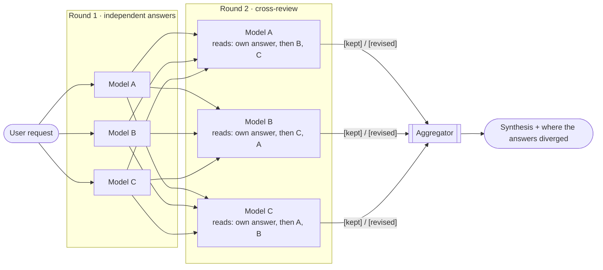

**Mixture-of-Agents (MoA)** runs the same prompt across **several models in parallel** (the *proposers*) and then uses an **aggregator** to synthesize a single high-quality answer from all proposals. With **layers**, the proposers first **review each other's answers** for one or more rounds, so the aggregator works from answers that were already cross-examined. The technique is based on [Wang et al., arXiv:2406.04692](https://arxiv.org/abs/2406.04692), whose reference implementation ([togethercomputer/MoA](https://github.com/togethercomputer/MoA)) uses the same layered design.

<Frame caption="/moa --layers 2 with four providers: independent answers, a cross-review round where each model keeps or revises its position, then the synthesis. Later, the coder calls the @moa tool with layers and the panel streams inside the tool box.">
  <video controls muted playsInline poster="/images/moa-layers-poster.png" src="/images/moa-layers.mp4" aria-label="ChatCLI running /moa with two layers across four providers, then the coder calling the @moa tool" />
</Frame>

<Info>
MoA is **distinct** from [Multi-Agent Orchestration](/agents/multi-agent-orchestration): there the axis is **specialist agents** (planner, reviewer…) dispatched in parallel within a task. Here the axis is **model/provider diversity** answering the same question. Triggered by the `/moa` command.
</Info>

---

## How it works

```text
/moa <prompt>
     │
     ├─ proposer 1 (openai:gpt-5)        ┐
     ├─ proposer 2 (claudeai:opus-4-8)   ├─ in parallel, same prompt
     ├─ proposer 3 (googleai:gemini-2.5) ┘
     │
     ▼
  aggregator (active provider/model, or CHATCLI_MOA_AGGREGATOR)
     │
     ▼
  single synthesized answer
```

1. **Shared briefing** — the same structured system prompt of a chat turn (contexts attached via `/context attach`, workspace memory, skills, per-turn retrieval) is assembled **once per round** and handed to every participant.
2. **Parallel proposal** — each proposer receives the same prompt and the same briefing, concurrently, and may pull knowledge, CCR and memory (read-only) before answering.
3. **Fault tolerance** — a proposer's error is tolerated; MoA proceeds as long as **at least one** answered. It only fails if the aggregator itself fails.
4. **Panel positions** — each proposer's position prints the moment its answer lands, with its elapsed time, so you see where the models agree and where they split before the synthesis arrives.
5. **Aggregation** — the aggregator gets a synthesis prompt with all proposals, **plus the same briefing and the same tools**, and produces **one** correct, cohesive answer. When the proposals disagree on a material point, the answer ends with a short **"Where the answers diverged"** section: the competing positions and which one it took, and why. Models are never named.

A **5-minute** timeout wraps each round (so `--layers 2` gets 10 minutes). `/moa` also works in one-shot: `chatcli -p "/moa <prompt>"` (exits non-zero if the round fails).

---

## Layers: the models review each other

By default `/moa` runs **one layer**: independent answers, then the synthesis. Ask for more layers and every round after the first is a **cross-review**: each model reads its own previous answer and the other models' answers, then writes an improved answer of its own. The aggregator synthesizes the **last** round.

```text
/moa --layers 2 Should I replace Cluster Autoscaler with Karpenter?
```



What each model gets in a review round:

1. **The user's request**, exactly as asked, with the same briefing and read-only tools as round 1.
2. **Its own previous answer**, marked as its own.
3. **The other models' answers**, anonymous and **rotated**: model A reads B then C, model B reads C then A, model C reads A then B. No answer always sits in the first slot, so no model's view gets the advantage of being read first.
4. **The instruction**: evaluate all of them critically (its own included, since some may be biased, outdated or wrong), keep the positions it can defend, adopt a better argument where another model made one, fix every error, and **don't agree just to converge**.

Each model opens its review with a `[kept]` or `[revised]` marker. ChatCLI strips the marker before anyone reads the answer and shows it in the panel, so you can see whether the panel converged or held its ground:

```text
  Round 1/2 · independent answers (4 models)
    ✓ openai:gpt-6.1-sol  8.9s
      Don't replace it directly.
    ✓ googleai:gemini-3.1-pro-preview  13.6s
      Yes. Karpenter is mature (GA) and widely recommended by AWS for EKS…
    ✓ xai:grok-4.5-latest  16.2s
      Not necessarily.
    ✓ claudeai:claude-opus-5-5  18.3s
      Yes, in most cases it's worth it, but migrate gradually…
  Round 2/2 · cross-review: each model reads the others and revises (4 models)
    ✓ googleai:gemini-3.1-pro-preview  36.9s  ↻ revised
      It depends on your current pain.
    ✓ openai:gpt-6.1-sol  47.2s  = kept
      Don't replace it by default.
    ✓ xai:grok-4.5-latest  48.7s  = kept
      No. On a production EKS with critical workloads, don't swap…
    ✓ claudeai:claude-opus-5-5  58.2s  ↻ revised
      Yes, but only with a concrete gain (slow scale-up, high cost, many node groups, Spot)…
  Synthesizing with claudeai:claude-opus-5-5...
```

The envelope over the synthesis reports the rounds: `4/4 models · 2 rounds · 65.7s`.

| Situation | What happens |
| --- | --- |
| A model fails a review round | It keeps its previous answer, which still reaches the next round and the aggregator. |
| A model gave no answer in round 1 | It leaves the panel. It is not called again. |
| Only one model answered | Review rounds are skipped: there are no peers to read. |
| A model omits the marker | Its answer is used as is, with no badge. |

### What changes with more layers

Each extra layer is **one more cross-review**: every model reads the answers of the round before, which were already reviewed once, and revises again. The aggregator always reads only the last round.

| Layers | What the aggregator reads | Calls (4 models) | Wall time |
| --- | --- | --- | --- |
| 1 (default) | 4 independent answers | 4 + 1 aggregator = **5** | slowest model + synthesis |
| 2 | 4 answers, each revised after reading the other 3 | 8 + 1 = **9** | slowest of round 1 + slowest of round 2 + synthesis |
| 3 | 4 answers revised twice | 12 + 1 = **13** | one more slowest-model round |
| 4 (max) | 4 answers revised three times | 16 + 1 = **17** | one more slowest-model round |

In general: **N models × L layers + 1** calls, and each round waits for its slowest model. A review call is also bigger than a first-round call: its prompt carries the model's own answer plus the N−1 other answers, so input tokens grow with the panel size.

What you gain:

- **Errors get caught by peers.** A model that cited a deprecated API or a wrong number sees another model's correct version and fixes it before the synthesis.
- **Better arguments spread.** A point only one model raised in round 1 reaches all of them in round 2.
- **You see who changed their mind.** The `↻ revised` / `= kept` badges show, round by round, which positions held up under review.

What to watch for:

- **Convergence by conformity.** Models tend to agree with what they read. The review instruction tells them to keep any position they can defend and not to agree just to converge, and the aggregator still reports where the answers diverged. Each round stays visible in the panel, so a position that was dropped is never lost from view.
- **Diminishing returns.** The MoA paper counts the aggregator as the last layer, so its main 3-layer configuration is `--layers 2` here. It reports that "the first response aggregation has the most significant boost on generation quality", and its per-layer ablation shows smaller gains from the next layer on. Each layer still costs as much as the one before.

<Tip>
**When to use layers.** Keep 1 layer for everyday questions. Use 2 layers for contested or high-stakes questions, where independent answers are likely to split: architecture trade-offs, migrations, security decisions. Go to 3 or 4 when the panel still splits after a review round and the decision justifies the extra calls.
</Tip>

---

## Panel briefing and tools

Every panel participant — proposers **and** aggregator — is as capable as a regular conversation turn: it gets the session's full briefing plus three **strictly read-only** tool exceptions, executed in a bounded loop (up to 4 tool rounds per participant), over both native tool-use and XML for providers without native support:

| Tool | What it does | When it is offered |
| --- | --- | --- |
| `knowledge` | Queries the [knowledge bases](/context/knowledge-base) attached to the session (search/get/toc) | Same gate as the chat exception: enabled + a base attached |
| `recall` | Expands `<<ccr:KEY>>` markers from [context compression](/context/context-compression) back into the original | Only when the compression layer is wired **and** the history actually carries a marker |
| `memory` | Recalls the user's [long-term memory](/context/bootstrap-memory) (profile, durable facts, preferences, notes) | `CHATCLI_MEMORY_MODE` other than `off` |

When any tool is active, the round's status line reports it: `Expert tools enabled for this panel: knowledge, recall, memory`.

<Note>
**Read-only by construction.** Memory access is pinned to the `recall` subcommand by the executor itself — the mutating forms (`remember`, `profile`, `forget`) are unreachable from a panel turn, even if a model smuggles one into the call arguments. `ask_user` and `graphview` are excluded on purpose: participants run in parallel and unattended. No exec, file or search tools, ever — the same rule chat mode enforces.
</Note>

---

## Configuration

| Variable | Description |
| --- | --- |
| `CHATCLI_MOA_MODELS` | Optional. Proposers as CSV `provider:model`. **Without it, `/moa` and `@moa` use the configured providers** (sorted, capped at 4). |
| `CHATCLI_MOA_AGGREGATOR` | Optional. Aggregator model (`provider:model`). Default: the session's active provider/model. |
| `CHATCLI_MOA_PANEL` | What `/moa` shows of each proposer: `lead` (its opening statement, one line, default), `full` (the whole answer) or `off` (only ✓/✗). Also the default of the `@moa` tool's `positions`. |
| `CHATCLI_MOA_LAYERS` | Number of rounds, 1 to 4 (default 1). From round 2 on, each model reviews the others' answers. `/moa --layers N` overrides it for one run. |

```bash
export CHATCLI_MOA_MODELS="openai:gpt-5,claudeai:claude-opus-4-8,googleai:gemini-2.5-pro"
export CHATCLI_MOA_AGGREGATOR="claudeai:claude-opus-4-8"   # optional
export CHATCLI_MOA_LAYERS=2                                 # optional: one cross-review round
```

<Info>
**Auth:** works with OAuth, not just API keys — when a proposer/aggregator matches the session's active provider, MoA **reuses the session client**, honoring the OAuth token (preferred over an API key when logged in) or forwarded tokens (server/gateway mode). Provider names are resolved case-insensitively (`openai` → `OPENAI`). The `/moa` command and the `@moa` tool share the same resolution and defaults, `CHATCLI_MOA_AGGREGATOR` and `CHATCLI_MOA_LAYERS` included.
</Info>

<Tip>
Use **different** providers as proposers to maximize diversity — that's where MoA's quality gain comes from. The aggregator usually performs best as a strong model (Opus, GPT-5).
</Tip>

---

## Usage

```text
> /moa Should I replace Cluster Autoscaler with Karpenter on a production EKS with critical workloads?
  Querying 3 models in parallel, then synthesizing...
    ✓ claudeai:claude-opus-5-5  18.0s
      Short answer: in most cases, yes.
    ✓ xai:grok-4.5-latest  20.1s
      Not as an automatic swap.
    ✓ openai:gpt-6.1-sol  29.5s
      I would not do a direct replacement.
  Synthesizing with claudeai:claude-opus-5-5...

  <single synthesized answer, rendered as Markdown>

  ## Where the answers diverged
  • Default stance: one answer favored migrating "in most cases"; the others tied it to a measurable gain…
```

Pass `--layers N` (or `--layers=N`) before the prompt to run cross-review rounds; the completer suggests the flag and its values:

```text
> /moa --layers 2 Should I replace Cluster Autoscaler with Karpenter on a production EKS?
```

A proposer that fails shows the provider's error on one line (`✗ googleai:… API error: status 404 …`) and the round goes on with the others.

Any configured provider can participate as a proposer or aggregator. See [Supported Models](/providers/supported-models).

---

## `@moa` tool (for the agent)

Besides the `/moa` command, there's the **`@moa` tool**, which the agent can invoke inside an agent/coder flow. It has the same capabilities as `/moa`: layers, the panel positions, the divergence section.

```text
<tool_call name="@moa" args='{"cmd":"ask","args":{"prompt":"Design a rate limiter for 1M rps"}}' />
<tool_call name="@moa" args='{"cmd":"ask","args":{"prompt":"Should we migrate to Karpenter?","layers":2,"positions":"lead"}}' />
<tool_call name="@moa" args='{"cmd":"list"}' />
```

| Arg | Description |
| --- | --- |
| `prompt` | The question (required). |
| `models` | Optional, e.g. `["openai","claudeai:claude-opus-5-5"]`. Default: `CHATCLI_MOA_MODELS`, else a set of configured providers. |
| `aggregator` | Optional `provider` or `provider:model`. Default: `CHATCLI_MOA_AGGREGATOR`, else the session model. |
| `layers` | Optional, 1 to 4. From round 2 on, each model reviews the others' answers (see [Layers](#layers-the-models-review-each-other)). Default: `CHATCLI_MOA_LAYERS`, else 1. |
| `positions` | Optional: `lead` (each model's bottom line per round), `full` (the same, plus every whole answer in an appendix after the synthesis; long with several rounds) or `off`. Default: `CHATCLI_MOA_PANEL`, else `lead`. |

**While it runs**, the tool streams the panel into the tool box: a header per round, each model as it answers with its `↻ revised` / `= kept` badge, then `Synthesizing with …`.

**What the agent gets back** is the panel's positions per round, then the synthesis (with its "Where the answers diverged" section when the models disagreed), then, with `positions: full`, every whole answer. The order matters: a long result cut to fit the agent's context loses the appendix, never who said what or the verdict. That way the calling model sees the same divergence you see in `/moa`, and can tell you which model changed its mind:

```text
Answer synthesized from: claudeai, openai, googleai, xai after 2 rounds of cross-review (aggregator: CLAUDEAI)

## Panel positions

### Round 1
- claudeai: Yes, in most cases it's worth it.
- openai: Don't replace it directly.

### Round 2 (cross-review: each model read the others' answers)
- claudeai [revised]: Yes, but only with a concrete gain.
- openai [kept]: Don't replace it by default.

## Synthesis
…
```

`@moa` members answer the **prompt alone**: they do not see the agent's transcript (its system prompt, tool protocol, tool calls and results), which would make them act as the agent instead of answering. The calling model writes a self-contained prompt with the facts, constraints and excerpts the panel needs, as the tool's description tells it to. Members keep the read-only panel tools (knowledge, memory).

It degrades gracefully: a single successful proposer is returned directly; if the aggregator is unavailable, the positions and the longest answer are returned instead of failing.

<Note>
In `/coder`, `@moa ask` follows the [coder policy](/coder/coder-security) like any tool: allow it in `coder_policy.json` (`{"pattern": "@moa ask", "action": "allow"}`) to skip the confirmation.
</Note>

---

## See also

- [Multi-Agent Orchestration](/agents/multi-agent-orchestration) — parallel specialist agents (different axis)
- [Environment Variables → Mixture-of-Agents](/reference/environment-variables#mixture-of-agents-moa)
