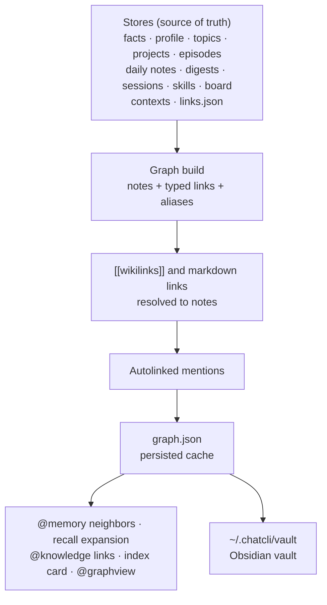

ChatCLI keeps what it knows in its own stores: facts, the profile, topics, projects, the episodic timeline, daily notes and digests, saved sessions, skills, the work board and `/context` contexts. The **knowledge graph** ties all of them together the way an Obsidian vault does. Every item is a **note**, notes point at each other through **typed, directed links**, every note has **backlinks**, and `[[wikilinks]]` work anywhere.

The graph serves three things:

- **The model navigates it** with [`@memory neighbors`](#memory-neighbors-the-local-graph) (and the `## Related (graph)` section of every `@memory recall`), [`@memory link`](#explicit-links) and [`@knowledge links`](#context-documents).
- **You open it as an Obsidian vault**: ChatCLI keeps one Markdown note per graph note in sync in `~/.chatcli/vault`. See [The vault](#the-obsidian-vault).
- **The per-turn index card** (counts by kind plus hubs) tells the model what exists, so it knows what to pull.



The stores stay the source of truth: sealed at rest, deduplicated and safe across processes. The graph is derived from them and cached in `~/.chatcli/memory/graph.json`; the vault is a projection of the graph. The only graph input that is not derived is `links.json`, which holds the links you draw on purpose.

## Notes

| Kind | Node id | What it is | Aliases (other names a `[[link]]` may use) |
|---|---|---|---|
| `fact` | `fact:<id>` | A long-term fact (the id is a hash of its content) | — |
| `topic` | `topic:<name>` | A recurring subject with its rolling summary | — |
| `project` | `project:<name>` | A tracked project | the base name of its path |
| `profile` | `profile:user` | You | `user` |
| `episode` | `episode:<id>` | A dated unit of work (the 300 most recent) | — |
| `note` | `note:daily:<YYYY-MM-DD>`, `note:weekly:<YYYY-Www>`, `note:monthly:<YYYY-MM>` | A daily note or a weekly/monthly digest | the date or period label (`2026-10-24`, `2026-W43`, `2026-10`) |
| `session` | `session:<name>` | A saved conversation (the 50 most recent) | the session name, when the title differs |
| `skill` | `skill:<name>` | An installed skill | — |
| `card` | `card:<id>` | A work-board card (its column is in the title) | the card title |
| `kbcontext` | `kb:<id>` | A `/context` context in `knowledge` mode | — |
| `context` | `ctx:<id>` | A `/context` context in any other mode | — |
| `doc` | `doc:<context id>:<source>` | One document of a context | its file name without extension |
| `tag` | `tag:<label>` | A tag, a fact category, a technology, a skill trigger, an assignee | — |

Tags are glue: they link notes that share them, but they are never listed as related notes. In the vault they become front-matter `tags`, not notes.

## Links

A link has a direction (the note that writes it points at the target), a **relation** and an **origin**.

| Relation | From → to | Weight |
|---|---|---|
| `tagged` | fact, context → tag | 1 |
| `category` | fact → its category tag | 0.5 |
| `in_project` | fact → project (by source path); episode → project; session → project (name match) | 2 · 2 · 1.5 |
| `about` | topic → fact | 2 |
| `uses` | project → technology tag | 1 |
| `has` | profile → skill or goal tag | 1 |
| `same_day` | episode → fact learned that day in the project; session → episode; daily note → episode and → fact of that day (up to 20) | 1 |
| `summarizes` | weekly digest → daily notes of its week; monthly digest → weeklies of its month | 1 |
| `part_of` | document → its context | 1 |
| `links_to` | a `[[wikilink]]` written in any note; a markdown link between documents | 1.5 |
| `mentions` | an autolinked mention (see below) | 1 |
| `triggered_by` | skill → topic of a trigger; skill → trigger tag | 1 · 0.5 |
| `assigned` | card → assignee tag | 1 |
| any name | an explicit link you drew | 2 |

| Origin | Meaning |
|---|---|
| `structural` | A relationship a store already records |
| `wikilink` | A `[[wikilink]]` in note text |
| `markdown` | A relative markdown link between documents |
| `mention` | An autolinked mention |
| `user` | An explicit link drawn with `@memory link` or `/memory link` |

The weights of every relationship the graph had before typed links existed are unchanged, so recall ranks exactly as it did; the typed links add direction, a reason and new connections on top.

### Wikilinks and name resolution

`[[target]]`, `[[target|label]]`, `[[target#heading]]`, `[[target^block]]` and embeds (`![[target]]`) are links wherever they are written: in a fact you asked ChatCLI to remember, a topic summary, an episode, a daily note, a card, a document. The target resolves to a note by:

1. the exact node id (`topic:auth`);
2. a title or alias, compared with accents removed, case folded and spaces, `-` and `_` treated alike (`[[Configuração do servidor]]` = `[[configuracao-do_servidor]]`).

When several notes share a name, the more specific kind wins: project, then topic, then context, skill, document, profile, journal note and session, card, episode, fact, tag. A target that names nothing is not an error; the link appears once the note exists.

### Autolinked mentions

Prose links itself. When the title or alias of a project, topic, skill or context appears in the text of a fact, topic, episode, project, card or journal note, that note gets a `mentions` link to it (Obsidian's "unlinked mentions", resolved automatically). The rules keep it precise:

- the name must appear as whole words (`Orbital` does not match `Orbitals`);
- names shorter than 3 characters, purely numeric names, and single words shorter than 4 characters or too generic (`user`, `project`, `test`, `code`, `dados`, `projeto`…) are not autolinked;
- a mention never restates a link the two notes already have;
- at most 8 mentions per note; the longest name wins at a position (`Kubernetes operator` over `Kubernetes`).

Documents and tags are not mention targets: file names and tag words are too generic to find in prose reliably. They still link through wikilinks, tags and explicit links.

## Explicit links

Some relationships are only in your head: "this gotcha is about that project", "this document explains that topic". Draw them, and they are recalled with either note.

<Tabs>
  <Tab title="The model (@memory)">
    ```text
    <tool_call name="@memory" args='{"cmd":"link","args":{"from":"3f9a1c02","to":"Orbital","rel":"about"}}' />
    <tool_call name="@memory" args='{"cmd":"link","args":{"from":"[[Setup]]","to":"topic:telemetry security","rel":"explains","note":"the TLS section"}}' />
    <tool_call name="@memory" args='{"cmd":"unlink","args":{"from":"3f9a1c02","to":"Orbital"}}' />
    ```
    `from`/`to` also accept `source`/`target`, `rel` also `relation`; `relate`, `connect` and `disconnect` work as subcommand names. `link` and `unlink` change memory, so they go through the confirmation policy like `remember`.
  </Tab>
  <Tab title="You (/memory)">
    ```bash
    /memory link telemetry security -> Orbital --rel about --note keeps the gateway notes together
    /memory link "Ingest gateway" "Orbital"
    /memory unlink telemetry security -> Orbital
    /memory links Orbital
    ```
    The arrow can also be `→`. `/memory links <note>` prints the same view as `@memory neighbors`. The note argument completes with the ids of the graph's hub notes.
  </Tab>
</Tabs>

A note reference is any of: a node id, a fact id or id prefix as `@memory list` shows it, a title or alias, a `[[wikilink]]`, or free text that names exactly one note. A reference that could mean several notes is refused with the candidates and their ids, so a link is never drawn to the wrong note.

The relation is a free name stored as a slug (`Depends On` → `depends_on`, default `related`); common words map onto the built-in relations (`mention` → `mentions`, `references` → `links_to`, `belongs_to` → `part_of`, `project` → `in_project`).

Explicit links live in `~/.chatcli/memory/links.json`:

- sealed at rest, written atomically, merged across processes under a file lock, quarantined if corrupt, read-only when sealed with a key this process does not have — like every memory store;
- a removal is a tombstone kept for 30 days, so another process never brings a removed link back;
- a link drawn to a fact that is later **superseded** follows the newer fact automatically, and memory compaction moves links from the facts it rewrites to the consolidated fact that restates them;
- a link whose note is gone **from the stores** is kept for 30 days (a context re-created, a fact re-learned) and then dropped by memory compaction. Notes that are only outside the graph's size caps (older sessions, older episodes, documents past the cap) still exist and never lose their links; tags and unknown ids are never collected;
- `/memory export` and `/memory import` carry links; fact ids are content hashes, so links survive moving memory to another machine;
- at most 10,000 links; a note on a link is one line of at most 280 bytes (longer notes are cut with an ellipsis).

`unlink` removes only explicit links. A link that comes from the data itself (a shared tag, the fact's project, a wikilink, a mention) is reported with its relation and origin: change the data to change it.

## Context documents

A context is not one opaque blob in the graph: every **document** in it is a note. Chunks of a `@docs-flatten` corpus fold back into the document they came from.

- **Title**: the front-matter `title`, else the first heading, else the file name. **Summary**: the first prose line (up to 200 characters).
- **Markdown links** between documents become `links_to` links: relative paths resolve against the document's own folder; `#anchors` and `?queries` are ignored; the extension is optional (`.md`, `.mdx`, `.markdown`, `.html`); a link to a folder lands on its `README` or `index`; a site-absolute link (`/guide/setup`) resolves from the corpus root or by a unique path suffix. Links to URLs, `mailto:`, `data:` and in-page anchors are not document links.
- **Wikilinks** in a document resolve against the document titles and file names of the same context first, then against the whole vault: a page can link to a memory topic or project.
- **Bounds**: up to 2,000 documents per context and 6,000 in the whole graph (the contexts you created first keep theirs), and up to 64 links per document. Every document stays searchable through retrieval either way.
- Windows paths are handled: scanned contexts keep `\` in their paths, links inside documents use `/`.

The document graph is derived once per context revision and memoized, so it costs nothing on later rebuilds.

The model follows these links with `@knowledge`:

```text
<tool_call name="@knowledge" args='{"cmd":"links","args":{"source":"docs/gateway.md"}}' />
```

```text
handbook :: docs/guide/gateway.md — "Ingest gateway"
  · Terminates mTLS.
→ links to (1):
  - docs/guide/setup.md — "Getting set up"
← linked from (2):
  - docs/guide/index.md — "Guide index"
  - docs/guide/setup.md — "Getting set up"
[[wikilinks]] to notes outside this base (see @memory neighbors): Orbital
```

A cited chunk id (`docs/gateway.md#0002`) works as `source` too. `backlinks`, `related` and `see_also` are accepted as names of the subcommand. Every `@knowledge search` also ends with up to 6 **linked documents** of the top results that are not among them:

```text
Linked documents (not in the results above; read with get, or links for more):
- handbook :: docs/guide/setup.md (linked from docs/guide/gateway.md)
- handbook :: docs/guide/index.md (links to docs/guide/gateway.md)
```

## `@memory neighbors`: the local graph

`neighbors` shows a note and what is around it, two hops deep, with the relation of every direct neighbor: `→` for links the note writes, `←` for backlinks.

```text
Local graph of "orbital" (project:orbital):
Connected (→ links it writes, ← backlinks):
  - [fact] Orbital streams telemetry over gRPC with mTLS  (← in_project)
  - [card] [doing] rotate Orbital certificates — before the deploy window  (← mentions)
  - [doc] Ingest gateway — Terminates mTLS. See [[Setup]] and [[Orbital]].  (← links_to)
  - [topic] telemetry security — mTLS between collectors and the ingest gateway
```

The query can be a node id, a title, an alias or a `[[wikilink]]`, which name a note exactly; other text falls back to the best keyword match. `@memory map` gives the overview: node counts by kind and the hub notes. The legacy names `links`, `backlinks` and `related` still mean `neighbors`.

**Recall uses the graph.** The top facts of every `@memory recall` (and of `full` mode injection) are expanded one hop, and the structurally adjacent notes that ranking missed go into a `## Related (graph)` section; the proactive auto-recall adds a one-line `Related (graph):` pointer. See [Bootstrap and Memory](/context/bootstrap-memory#knowledge-graph-memory-neighbors--map).

**The index card** injected each turn lists node counts by kind and up to 8 hubs. Documents are counted but never listed as hubs, so a densely linked corpus does not crowd your own projects and topics out of the card.

**`@graphview`** with `source=knowledge` draws the whole graph; selecting an edge shows the relations behind it (`about · mentions`). See [Interactive graph](/tools/graphview).

## The Obsidian vault

ChatCLI keeps the graph as an Obsidian-compatible vault: open `~/.chatcli/vault` as a vault in Obsidian (or read it in any editor or with git).

```text
~/.chatcli/vault/
|-- Home.md                                   # map of content: the index card, then every profile, project, topic, context, skill, card, journal note, session
|-- Profile/<name>.md
|-- Projects/<name>.md
|-- Topics/<name>.md
|-- Facts/<category>/<title> (<id>).md
|-- Episodes/<year>/<date> <title> (<id>).md
|-- Journal/Daily/2026-10-24.md               # the names Obsidian's daily-notes plugin uses
|-- Journal/Weekly/2026-W43.md
|-- Journal/Monthly/2026-10.md
|-- Sessions/<name>.md
|-- Skills/<name>.md
|-- Board/<column>/<title> (<id>).md
|-- Contexts/<context>/<context>.md           # folder note: the context and its document list
|-- Contexts/<context>/<path of each document>  # a .md document keeps its name, other files get .md appended
+-- .chatcli/manifest.json                    # what the vault wrote (Obsidian ignores dot folders)
```

Every note has YAML front matter and a `## Links` section:

```markdown
---
chatcli_id: fact:ab37259d1cbc0a08a73db347
kind: fact
aliases:
  - Orbital streams telemetry over gRPC with mTLS
tags:
  - grpc
  - security
category: architecture
confidence: "0.70"
provenance: extraction
source_project: /repo/orbital
created: 2026-10-24T12:00:00Z
last_accessed: 2026-10-24T12:00:00Z
---

# Orbital streams telemetry over gRPC with mTLS

Orbital streams telemetry over gRPC with mTLS

## Links

- in project → [[Projects/orbital]]
```

| Kind | Front-matter fields besides `chatcli_id`, `kind`, `aliases`, `tags` |
|---|---|
| fact | `category`, `confidence`, `provenance`, `source_project`, `created`, `last_accessed` |
| topic | `mentions`, `first_seen`, `last_seen` |
| project | `path`, `status`, `last_active`, `technologies` |
| episode | `date`, `project`, `source` |
| card | `column`, `assignee`, `created`, `updated` |
| context | `mode`, `files`, `updated` |
| document | `source`, `context` |

- **Links** list the note's outgoing links grouped by relation, as wikilinks with the exact note path (`[[Folder/Note|Title]]`); Obsidian computes the backlinks. A link you drew says `· linked by you`, with its note.
- **Wikilinks inside the text** (a fact, a document, a daily note) are rewritten to the exact path of the note the graph resolves them to, keeping `#heading` and `|label`, so they work in Obsidian even when the target is an alias, a title that differs from its file name, or a note in another folder. Fenced code blocks are left alone; a target that names nothing stays as written.
- **Documents** carry their full content (up to 1 MiB per note) after a `> Source:` line, with secrets masked by the same redactor the model path uses; source code is shown in a fenced block and never rewritten (links and `[[…]]` are parsed only in Markdown, outside fenced code). A document's path is kept relative to the folder its context's documents share. Journal notes carry their full text; the profile lists its fields.

### Sync

The vault syncs in the background: a few seconds (5 s of quiet, at most 60 s) after memory changes, and 10 s after start. It is incremental. A note is rewritten only when its content changed, and a document is not even re-read unless its context or its links changed; on a synthetic store of about 2,800 notes the first sync took about 2.1 s and a sync with nothing to write about 0.4 s.

It is safe to work in the vault:

- **Your edits are kept.** A note you changed is not overwritten and not removed; `/memory vault` lists it as kept. `/memory vault sync --force` regenerates ChatCLI's own notes.
- **Files ChatCLI did not write are never touched**, even with `--force`: add your own notes, canvases and attachments freely.
- A note ChatCLI no longer produces is removed only if you did not edit it, and empty folders go with it.
- Writes are atomic; files are `0600` and folders `0700`. A sync stopped by shutdown removes nothing, and a corrupt manifest makes the next sync keep every file.
- File names are portable: characters that Windows, Obsidian or link syntax reject are replaced, names are bounded, and two notes whose names differ only by case get distinct files.

<Warning>
The vault is **plaintext** even with [encryption at rest](/security/encryption-at-rest) on: it exists to be read in an editor. Profile fields flagged sensitive (`sensitive_mark`), or whose key marks them as private (finance, documents, contact, health, family…), are shown as `‹private›`, a private profile name is replaced by `user` everywhere (file name, heading, links, Home), private skill and goal lists add no tags, secrets in documents and journal notes are masked, and session transcripts never enter it (session notes carry the title and links only). In the chat gateway with per-sender isolation, every sender has its own vault in its own state directory (`CHATCLI_MEMORY_VAULT_DIR` relocates only the main one), and syncs of the same vault from several processes are serialized with a file lock. Turn it off with `CHATCLI_MEMORY_VAULT=false`; an existing vault is then left in place for you to delete.
</Warning>

### Commands and settings

```bash
/memory vault                # where it is, and how the last sync went
/memory vault sync           # sync now (works even when automatic generation is off)
/memory vault sync --force   # also regenerate notes you edited
/memory vault path           # print the folder, to open in Obsidian
```

| Variable | Default | Description |
|---|---|---|
| `CHATCLI_MEMORY_VAULT` | `true` | Keep the vault in sync in the background (`false`, `off`, `0`, `no` turn it off) |
| `CHATCLI_MEMORY_VAULT_DIR` | `~/.chatcli/vault` | Vault location (a leading `~` is expanded); by default `vault` next to the memory directory, so under `CHATCLI_STATE_DIR` when that is set. Gateway senders with isolation always use their own state directory |
| `CHATCLI_MEMORY_GRAPH` | `true` | Persisted graph cache and recall expansion (see [Bootstrap and Memory](/context/bootstrap-memory)) |
| `CHATCLI_GRAPH_INDEX` | `true` | Per-turn index card |

`/config memory` shows the explicit link count, both vault variables and the last sync. The vault is generated in every mode, the server included. In Kubernetes, the Helm chart has `memory.vault.enabled` and `memory.vault.dir`, and the operator `spec.features.memory.vault`; at the default path the vault is not on a persistent volume, so it is rebuilt on every start.

## Upgrading

Nothing to do. The stores keep their format and nothing is converted. A `graph.json` written by an older version (schema 1) is discarded on the first start and rebuilt from the stores, now with typed links; `links.json` and the vault start empty and fill on their own. A test that builds the same memory with the previous graph builder and the new one checks that every note and every link users had before is still there, with at least the same weight.

On the same synthetic store (about 2,800 notes and 7,900 links, 2,000 of them documents), building the graph took about 28 ms the first time and 8 ms on later rebuilds, and `graph.json` was about 3.2 MB; the file holds the typed links and only the adjacency they do not explain.
