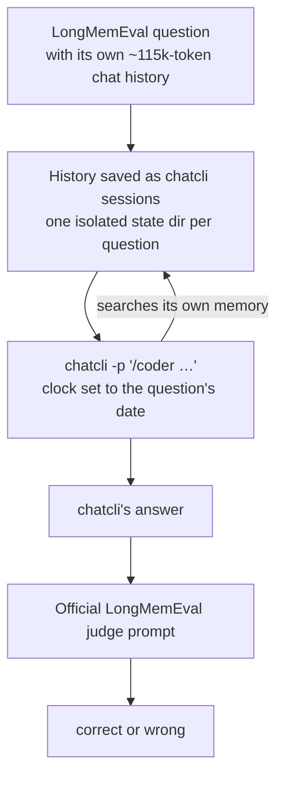

An assistant you work with for months has to remember what you told it: the decision from three weeks ago, the number you corrected last Tuesday, the city you moved to, and also when to say "you never told me that". **LongMemEval** measures exactly this, and we ran all 500 of its questions through chatcli.

<CardGroup cols={4}>
  <Card title="90.8%" icon="bullseye">
    454 of 500 questions answered correctly
  </Card>
  <Card title="90.0%" icon="flask">
    on the 440 questions never used to tune chatcli
  </Card>
  <Card title="469 / 470" icon="magnifying-glass">
    questions where chatcli's search surfaced the evidence
  </Card>
  <Card title="22 s · $0.08" icon="gauge-high">
    median time and average cost per question
  </Card>
</CardGroup>

<Frame>
  
  
</Frame>

<Card title="The story behind the numbers" icon="linkedin" href="https://www.linkedin.com/pulse/fiz-500-perguntas-%C3%A0-mem%C3%B3ria-do-meu-agente-ele-acertou-edilson-freitas-fyqff/">
  The article on LinkedIn walks through all 500 questions, the real failures, the bugs the run found and what changed afterwards. Written in Portuguese.
</Card>

---

## What LongMemEval is

[LongMemEval](https://github.com/xiaowu0162/LongMemEval) is a benchmark from the paper *LongMemEval: Benchmarking Chat Assistants on Long-Term Interactive Memory* (Di Wu, Hongwei Wang, Wenhao Yu, Yuwei Zhang, Kai-Wei Chang and Dong Yu, **ICLR 2025**). It has 500 hand-curated questions. Each question comes with its own timestamped history of chat sessions. In the **S** variant that history is about 115k tokens, roughly 40 to 50 sessions of everyday conversation, and the evidence for the answer sits somewhere inside.

The questions test five abilities:

| Ability | What it asks | Example from the dataset |
|---|---|---|
| **Information extraction** | recall a detail the user or the assistant said | "What degree did I graduate with?" |
| **Multi-session reasoning** | combine facts spread across sessions | "How many MCU films did I watch in the last 3 months?" |
| **Temporal reasoning** | reason about when things happened | "How many weeks ago did I start using Ibotta?" |
| **Knowledge updates** | use the latest value when a fact changed | "How many pre-1920 coins do I have?" (37, later 38) |
| **Abstention** | say so when the history does not contain the answer | "At which university did I present a poster for my undergrad course research project?" (never said) |

### Why it matters

- **It is hard on purpose.** The paper reports that commercial chat assistants and long-context LLMs show a 30% accuracy drop on memorizing information across sustained interactions. A bigger context window alone does not solve it.
- **It tests the failure users actually see.** An assistant that forgets a correction, mixes up two trips or invents an answer it was never given loses trust fast. LongMemEval scores each of those separately.
- **It is reproducible.** The dataset, the questions, the gold answers and the judge prompts are public (MIT), so anyone can rerun it and compare.

---

## How chatcli was tested

The goal was to test chatcli the way you use it, not to test the model. **Nothing was pasted into the prompt.** Each question's history became chatcli's own saved sessions, and chatcli had to find the evidence through its memory tools.



<Steps>
  <Step title="One isolated installation per question">
    A fresh [`CHATCLI_STATE_DIR`](/reference/environment-variables) holds the question's history as saved sessions; each file's modification time is the session's date. Your real memory never mixes in, and your login is reused in place through `CHATCLI_AUTH_DIR`.
  </Step>
  <Step title="The clock set to the question's day">
    [`CHATCLI_NOW`](/reference/environment-variables) is the question date, so "two weeks ago" means two weeks before the question, not two weeks before the run.
  </Step>
  <Step title="chatcli answers by itself">
    `chatcli -p "/coder …"` with Claude Sonnet 5.5 and one neutral instruction: answer from our previous conversations, say so if they do not contain the answer. chatcli decides which tools to call.
  </Step>
  <Step title="The official judge">
    Each answer is graded with the official LongMemEval answer-check prompts, unchanged, run with Claude Sonnet 5.5.
  </Step>
</Steps>

---

## Results

**454 of 500 correct: 90.8%** (95% confidence interval 87.9%–93.0%). Averaged across the six question types, so each type weighs the same: **92.2%**.

| Question type | Correct | Accuracy | 95% CI |
|---|---|---|---|
| Facts the user said | 70/70 | **100.0%** | 94.8–100.0% |
| Facts the assistant said | 56/56 | **100.0%** | 93.6–100.0% |
| Knowledge updates | 74/78 | **94.9%** | 87.5–98.0% |
| Temporal reasoning | 117/133 | **88.0%** | 81.4–92.5% |
| Preferences | 26/30 | **86.7%** | 70.3–94.7% |
| Multi-session reasoning | 111/133 | **83.5%** | 76.2–88.8% |
| Abstention (unanswerable, across types) | 27/30 | **90.0%** | |

### Held-out score

Before the full run, a 60-question sample (10 per type, fixed seed) was used to find and fix weaknesses in chatcli. Those 60 scored 96.7% in the final run, so they are not a neutral test. **On the other 440 questions chatcli scored 396/440 = 90.0%** (95% CI 86.8%–92.5%), with the same 92.2% task average. That is the conservative number.

---

## Where it fails

The run records, for every question, which saved sessions hold the answer according to the dataset's labels and whether those sessions reached the model. That separates **finding** from **reasoning**.

<Frame>
  
  
</Frame>

**Search is not the bottleneck.** The session holding the answer reached the model in 469 of 470 answerable questions. Of the 46 misses, only one was a retrieval miss. The rest are judgment:

- **Counting across sessions** (multi-session, 22 misses): "How many projects have I completed since I started painting classes?" — chatcli found 4 of the 5.
- **Date arithmetic and ordering** (temporal, 16 misses): "Which book did I finish first?" when one session says "last weekend" and another "just finished".
- **Too cautious**: in 9 questions the evidence was in front of the model and it answered "that is not in our conversations".
- **Too eager**: in 3 of the 30 unanswerable questions it guessed instead of abstaining.

<Note>
Two of the 46 misses had a different cause, found by reading the transcripts: a search for "St. Mary's Church" carried an unescaped apostrophe that cut the tool call short. That parser bug is fixed in [#1842](https://github.com/diillson/chatcli/pull/1842), and both questions pass when rerun. The 90.8% above is the score as measured, without that fix.
</Note>

---

## Cost and speed

| | |
|---|---|
| Median time per question | 22.0 s (p90 37.1 s, max 80.0 s) |
| Average cost per question | $0.083 answering (p95 $0.126) |
| Whole run | $41.39 answering + $1.89 judging, about 1 hour with 4 in parallel |
| Input tokens per question | 71k average |
| Tool calls per question | 4.9 average |
| Failed runs | 0 of 500 |

chatcli used `@session search` 1,068 times, `@session get` 967 times and `@memory recall` 344 times. In 66 questions it narrowed searches by date on its own, with the `from`, `to` and `as_of` flags of [session search](/context/session-search#dates-from-to-and-as_of) (137 calls). It never went to the web.

---

## What the benchmark changed in chatcli

Running LongMemEval found real bugs, and each one was fixed in chatcli itself, not in the test:

| Change | What was wrong |
|---|---|
| [`CHATCLI_NOW`](/reference/environment-variables) (#1833) | relative dates were always counted from today, so a conversation replayed from the past read "two weeks ago" against the wrong day |
| `CHATCLI_STATE_DIR` (#1835) | there was no way to run a separate, isolated installation without changing `HOME` |
| OAuth refresh across processes (#1836) | two chatcli processes renewing a token at once could log the user out |
| Session ages from the reference date (#1837) | the age next to each saved session used the wall clock: "1282 days ago" instead of "21 days ago" |
| Never cut a UTF-8 character (#1838) | about 130 text caps could split a character, sending invalid UTF-8 to the model |
| `--timeout` covers stdin (#1839) | `chatcli -p` with an open stdin waited forever |
| Dated search hits, `from` / `to` / `as_of` (#1840) | search results carried no date; a window with only an end date was ignored |
| Apostrophes in tool arguments (#1842) | a query like "St. Mary's" cut the tool call and tripped the security gate |

On the 60-question sample, these changes took temporal reasoning from 8/10 to 10/10, knowledge updates from 8/10 to 9/10 and multi-session from 9/10 to 10/10, with no question going the other way.

---

## Read the numbers honestly

<AccordionGroup>
  <Accordion title="Not directly comparable with GPT-4o-judged scores">
    The paper's reference judge is GPT-4o. This run used the same official prompts with Claude Sonnet 5.5 as the judge, so the score is not directly comparable with leaderboard numbers judged by GPT-4o.
  </Accordion>
  <Accordion title="The 60 tuning questions">
    The 60-question sample guided the fixes above. The held-out 90.0% on the other 440 is the number that was never seen while tuning.
  </Accordion>
  <Accordion title="One run per question">
    Models vary between runs. A question near the edge can flip either way on a rerun.
  </Accordion>
  <Accordion title="What 'evidence surfaced' means">
    An evidence session's name appeared in what the model saw: search results, the auto-recall block or a page it read. It shows retrieval reached the right conversation, not that the model read the exact sentence.
  </Accordion>
  <Accordion title="Session names carry dates">
    Saved sessions were named `chat-<date>-<index>`; the dataset's own ids would have revealed which sessions hold the answer. The date in the name is the same information every search hit shows.
  </Accordion>
</AccordionGroup>

---

## The data

Everything from the run is public in the chatcli repository, under [`evals/longmemeval`](https://github.com/diillson/chatcli/tree/main/evals/longmemeval):

| File | What it holds |
|---|---|
| `results/2026-10-20/manifest.json` | commit, binary and dataset sha256, models, prompt, settings, start and end time |
| `results/2026-10-20/results.jsonl` | all 500 questions: the gold answer, chatcli's answer, the verdict, time, tokens, cost, every tool call, and which evidence sessions were seen and opened |
| `results/2026-10-20/summary.json` | every aggregate on this page, with confidence intervals and the failure list |
| `results/2026-10-20/failure-transcripts.jsonl.gz` | the full chatcli transcripts of the 46 misses |
| `lme.py`, `analyze.py`, `judge_prompts.py` | the driver, the analysis and the official judge prompts |

### Run it yourself

```bash
curl -LO https://huggingface.co/datasets/xiaowu0162/longmemeval-cleaned/resolve/main/longmemeval_s_cleaned.json
go build -o chatcli-bench .
: > empty.env
python3 -I evals/longmemeval/lme.py --data longmemeval_s_cleaned.json --out run \
  --bin ./chatcli-bench --dotenv empty.env --per-type 1000 --workers 4 < /dev/null
python3 -I evals/longmemeval/analyze.py run
```

You need a Claude login in chatcli (OAuth or API key). Related pages: [Memory](/context/bootstrap-memory), [Conversation search](/context/session-search), [Evals](/agents/harness/evals).
