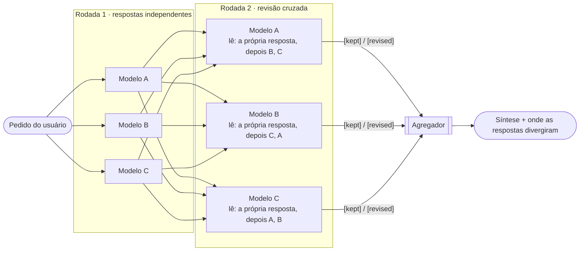

O **Mixture-of-Agents (MoA)** roda o mesmo prompt em **vários modelos em paralelo** (os *proponentes*) e então usa um **agregador** para sintetizar uma única resposta de alta qualidade a partir de todas as propostas. Com **camadas**, os proponentes primeiro **revisam as respostas uns dos outros** por uma ou mais rodadas, e o agregador trabalha sobre respostas que já passaram por revisão cruzada. A técnica é baseada em [Wang et al., arXiv:2406.04692](https://arxiv.org/abs/2406.04692), cuja implementação de referência ([togethercomputer/MoA](https://github.com/togethercomputer/MoA)) usa o mesmo desenho em camadas.

<Frame caption="/moa --layers 2 com quatro provedores: respostas independentes, uma rodada de revisão cruzada em que cada modelo mantém ou revisa a posição, e a síntese. Depois, o coder chama a tool @moa com camadas e o painel aparece dentro da caixa da tool.">
  <video autoPlay muted loop playsInline controls poster="/images/moa-layers-poster.png" src="/images/moa-layers.mp4" aria-label="ChatCLI rodando /moa com duas camadas em quatro provedores e, depois, o coder chamando a tool @moa" />
</Frame>

<Info>
MoA é **distinto** da [Orquestração Multi-Agent](/pt/agents/multi-agent-orchestration): lá o eixo é **agents especialistas** (planner, reviewer…) despachados em paralelo dentro de uma tarefa. Aqui o eixo é a **diversidade de modelos/provedores** respondendo à mesma pergunta. Acionado pelo comando `/moa`.
</Info>

---

## Como funciona

```text
/moa <prompt>
     │
     ├─ proponente 1 (openai:gpt-5)        ┐
     ├─ proponente 2 (claudeai:opus-4-8)   ├─ em paralelo, mesmo prompt
     ├─ proponente 3 (googleai:gemini-2.5) ┘
     │
     ▼
  agregador (provider/modelo ativo, ou CHATCLI_MOA_AGGREGATOR)
     │
     ▼
  resposta única sintetizada
```

1. **Briefing compartilhado** — o mesmo system prompt estruturado de um turno de chat (contextos anexados via `/context attach`, memória do workspace, skills, retrieval por turno) é montado **uma vez por rodada** e entregue a todos os participantes.
2. **Proposta paralela** — cada proponente recebe o mesmo prompt e o mesmo briefing, concorrentemente, podendo puxar knowledge, CCR e memória (read-only) antes de responder.
3. **Tolerância a falhas** — erros de um proponente são tolerados; o MoA segue desde que **pelo menos um** tenha respondido. Só falha se o agregador em si falhar.
4. **Posições do painel** — a posição de cada proponente aparece assim que a resposta dele chega, com o tempo decorrido, então você vê onde os modelos concordam e onde divergem antes da síntese.
5. **Agregação** — o agregador recebe um prompt de síntese com todas as propostas, **mais o mesmo briefing e as mesmas tools**, e produz **uma** resposta correta e coesa. Quando as propostas divergem num ponto relevante, a resposta termina com uma seção curta **"Onde as respostas divergiram"**: as posições em disputa, qual delas foi adotada e por quê. Os modelos nunca são nomeados.

Um timeout de **5 minutos** envolve cada rodada (com `--layers 2`, são 10 minutos). O `/moa` também funciona em one-shot: `chatcli -p "/moa <prompt>"` (sai com código diferente de zero se a rodada falhar).

---

## Camadas: os modelos revisam uns aos outros

Por padrão o `/moa` roda **uma camada**: respostas independentes e, em seguida, a síntese. Peça mais camadas e toda rodada depois da primeira vira uma **revisão cruzada**: cada modelo lê a própria resposta anterior e as respostas dos outros modelos, e escreve uma resposta melhor, sua. O agregador sintetiza a **última** rodada.

```text
/moa --layers 2 Devo substituir o Cluster Autoscaler pelo Karpenter?
```



O que cada modelo recebe numa rodada de revisão:

1. **O pedido do usuário**, exatamente como foi feito, com o mesmo briefing e as mesmas tools read-only da rodada 1.
2. **A própria resposta anterior**, marcada como sua.
3. **As respostas dos outros modelos**, anônimas e **rotacionadas**: o modelo A lê B e depois C, o B lê C e depois A, o C lê A e depois B. Nenhuma resposta fica sempre na primeira posição, então nenhuma visão leva a vantagem de ser lida primeiro.
4. **A instrução**: avaliar todas criticamente (inclusive a própria, já que algumas podem estar enviesadas, desatualizadas ou erradas), manter as posições que consegue defender, adotar um argumento melhor quando outro modelo o trouxe, corrigir todo erro e **não concordar só para convergir**.

Cada modelo abre a revisão com um marcador `[kept]` ou `[revised]`. O ChatCLI remove o marcador antes que alguém leia a resposta e o mostra no painel, para você ver se o painel convergiu ou manteve as posições:

```text
  Rodada 1/2 · respostas independentes (4 modelos)
    ✓ openai:gpt-6.1-sol  8.9s
      Não substitua diretamente.
    ✓ googleai:gemini-3.1-pro-preview  13.6s
      Sim. O Karpenter já atingiu maturidade (GA) e é amplamente recomendado pela AWS para EKS…
    ✓ xai:grok-4.5-latest  16.2s
      Não necessariamente.
    ✓ claudeai:claude-opus-5-5  18.3s
      Sim, na maioria dos casos vale a pena, mas migre de forma gradual…
  Rodada 2/2 · revisão cruzada: cada modelo lê os outros e revisa (4 modelos)
    ✓ googleai:gemini-3.1-pro-preview  36.9s  ↻ revisou
      Depende do seu problema atual.
    ✓ openai:gpt-6.1-sol  47.2s  = manteve
      Não substitua por padrão.
    ✓ xai:grok-4.5-latest  48.7s  = manteve
      Não. Em EKS de produção com workloads críticos, não substitua…
    ✓ claudeai:claude-opus-5-5  58.2s  ↻ revisou
      Sim, mas só se houver ganho concreto (scale-up lento, custo alto, muitos node groups, Spot)…
  Sintetizando com claudeai:claude-opus-5-5...
```

O envelope da síntese informa as rodadas: `4/4 modelos · 2 rodadas · 65.7s`.

| Situação | O que acontece |
| --- | --- |
| Um modelo falha numa rodada de revisão | Mantém a resposta anterior, que segue para a próxima rodada e para o agregador. |
| Um modelo não respondeu na rodada 1 | Sai do painel e não é chamado de novo. |
| Só um modelo respondeu | As rodadas de revisão são puladas: não há colegas para ler. |
| Um modelo omite o marcador | A resposta é usada como está, sem selo. |

### O que muda com mais camadas

Cada camada extra é **mais uma revisão cruzada**: todo modelo lê as respostas da rodada anterior, que já foram revisadas uma vez, e revisa de novo. O agregador sempre lê só a última rodada.

| Camadas | O que o agregador lê | Chamadas (4 modelos) | Tempo total |
| --- | --- | --- | --- |
| 1 (padrão) | 4 respostas independentes | 4 + 1 agregador = **5** | modelo mais lento + síntese |
| 2 | 4 respostas, cada uma revisada depois de ler as outras 3 | 8 + 1 = **9** | mais lento da rodada 1 + mais lento da rodada 2 + síntese |
| 3 | 4 respostas revisadas duas vezes | 12 + 1 = **13** | mais uma rodada do modelo mais lento |
| 4 (máx.) | 4 respostas revisadas três vezes | 16 + 1 = **17** | mais uma rodada do modelo mais lento |

Em geral: **N modelos × L camadas + 1** chamadas, e cada rodada espera o seu modelo mais lento. Uma chamada de revisão também é maior que uma da primeira rodada: o prompt leva a resposta do próprio modelo mais as N−1 respostas dos outros, então os tokens de entrada crescem com o tamanho do painel.

O que você ganha:

- **Os colegas pegam erros.** Um modelo que citou uma API descontinuada ou um número errado vê a versão correta de outro modelo e corrige antes da síntese.
- **Os melhores argumentos se espalham.** Um ponto que só um modelo levantou na rodada 1 chega a todos na rodada 2.
- **Você vê quem mudou de ideia.** Os selos `↻ revisou` / `= manteve` mostram, rodada a rodada, quais posições resistiram à revisão.

Pontos de atenção:

- **Convergência por conformidade.** Modelos tendem a concordar com o que leem. A instrução de revisão manda manter toda posição defensável e não concordar só para convergir, e o agregador continua apontando onde as respostas divergiram. Cada rodada fica visível no painel, então uma posição abandonada nunca some de vista.
- **Retornos decrescentes.** O paper do MoA conta o agregador como a última camada, então a configuração principal dele, de 3 camadas, é o `--layers 2` daqui. Ele reporta que "a primeira agregação de respostas dá o maior ganho de qualidade", e a ablação por camada mostra ganhos menores a partir da camada seguinte. Ainda assim, cada camada custa o mesmo que a anterior.

<Tip>
**Quando usar camadas.** Mantenha 1 camada para perguntas do dia a dia. Use 2 camadas em perguntas disputadas ou de alto impacto, em que respostas independentes tendem a divergir: trade-offs de arquitetura, migrações, decisões de segurança. Vá para 3 ou 4 quando o painel ainda diverge depois de uma rodada de revisão e a decisão justifica as chamadas extras.
</Tip>

---

## Briefing e tools do painel

Cada participante do painel — proponentes **e** agregador — é tão capaz quanto um turno normal de conversa: recebe o briefing completo da sessão e três exceções de tools **estritamente read-only**, executadas em um loop limitado (até 4 rodadas de tool por participante), tanto via tool-use nativo quanto via XML para provedores sem suporte nativo:

| Tool | O que faz | Quando é oferecida |
| --- | --- | --- |
| `knowledge` | Busca nas [bases de conhecimento](/pt/context/knowledge-base) anexadas à sessão (search/get/toc) | Mesmo gate da exceção do chat: habilitada + base anexada |
| `recall` | Expande markers `<<ccr:KEY>>` da [compressão de contexto](/pt/context/context-compression) de volta ao original | Só quando a camada de compressão está ativa **e** o histórico realmente carrega um marker |
| `memory` | Recupera a [memória de longo prazo](/pt/context/bootstrap-memory) do usuário (perfil, fatos duráveis, preferências, notas) | `CHATCLI_MEMORY_MODE` diferente de `off` |

Quando alguma tool está ativa, a linha de status da rodada informa: `Ferramentas de especialista ativas neste painel: knowledge, recall, memory`.

<Note>
**Read-only por construção.** O acesso à memória é limitado ao subcomando `recall` pelo próprio executor — as formas mutantes (`remember`, `profile`, `forget`) são inalcançáveis a partir de um turno do painel, mesmo que um modelo tente contrabandeá-las nos argumentos. `ask_user` e `graphview` ficam de fora de propósito: os participantes rodam em paralelo e desassistidos. Nenhum tool de execução, arquivo ou busca — a mesma regra do chat.
</Note>

---

## Configuração

| Variável | Descrição |
| --- | --- |
| `CHATCLI_MOA_MODELS` | Opcional. Proponentes em CSV `provider:model`. **Sem ela, `/moa` e `@moa` usam os provedores configurados** (ordenados, cap 4). |
| `CHATCLI_MOA_AGGREGATOR` | Opcional. Modelo agregador (`provider:model`). Default: o provider/modelo ativo da sessão. |
| `CHATCLI_MOA_PANEL` | O que o `/moa` mostra de cada proponente: `lead` (a frase de abertura, uma linha, padrão), `full` (a resposta inteira) ou `off` (só ✓/✗). Também é o padrão do `positions` da tool `@moa`. |
| `CHATCLI_MOA_LAYERS` | Número de rodadas, de 1 a 4 (padrão 1). A partir da rodada 2, cada modelo revisa as respostas dos outros. O `/moa --layers N` sobrescreve numa execução. |

```bash
export CHATCLI_MOA_MODELS="openai:gpt-5,claudeai:claude-opus-4-8,googleai:gemini-2.5-pro"
export CHATCLI_MOA_AGGREGATOR="claudeai:claude-opus-4-8"   # opcional
export CHATCLI_MOA_LAYERS=2                                 # opcional: uma rodada de revisão cruzada
```

<Info>
**Autenticação:** funciona com OAuth, não só API key — quando um proponente/agregador coincide com o provider ativo da sessão, o MoA **reusa o client da sessão**, honrando o token OAuth (preferido sobre API key quando logado) ou tokens encaminhados (modo server/gateway). Nomes de provider são resolvidos de forma case-insensitive (`openai` → `OPENAI`). O comando `/moa` e o tool `@moa` compartilham a mesma resolução e os mesmos defaults, incluindo `CHATCLI_MOA_AGGREGATOR` e `CHATCLI_MOA_LAYERS`.
</Info>

<Tip>
Use provedores **diferentes** como proponentes para maximizar a diversidade — é daí que vem o ganho de qualidade do MoA. O agregador costuma render mais sendo um modelo forte (Opus, GPT-5).
</Tip>

---

## Uso

```text
> /moa Devo substituir Cluster Autoscaler por Karpenter em um EKS de produção com workloads críticos?
  Consultando 3 modelos em paralelo e sintetizando...
    ✓ claudeai:claude-opus-5-5  18.0s
      Resposta curta: na maioria dos casos, sim.
    ✓ xai:grok-4.5-latest  20.1s
      Não como “troca automática”.
    ✓ openai:gpt-6.1-sol  29.5s
      Eu não faria uma substituição direta.
  Sintetizando com claudeai:claude-opus-5-5...

  <resposta única sintetizada, renderizada em Markdown>

  ## Onde as respostas divergiram
  • Postura padrão: uma resposta defendia migrar "na maioria dos casos"; as outras condicionavam a migração a um ganho mensurável…
```

Passe `--layers N` (ou `--layers=N`) antes do prompt para rodar rodadas de revisão cruzada; o completer sugere a flag e os valores:

```text
> /moa --layers 2 Devo substituir o Cluster Autoscaler pelo Karpenter em um EKS de produção?
```

Um proponente que falha mostra o erro do provider em uma linha (`✗ googleai:… API error: status 404 …`) e a rodada segue com os demais.

Qualquer provedor configurado pode participar como proponente ou agregador. Veja [Provedores Suportados](/pt/providers/supported-models).

---

## Tool `@moa` (para o agente)

Além do comando `/moa`, existe o **tool `@moa`**, que o agente pode invocar dentro de um fluxo agent/coder. Ele tem as mesmas capacidades do `/moa`: camadas, as posições do painel e a seção de divergência.

```text
<tool_call name="@moa" args='{"cmd":"ask","args":{"prompt":"Design a rate limiter for 1M rps"}}' />
<tool_call name="@moa" args='{"cmd":"ask","args":{"prompt":"Devemos migrar para o Karpenter?","layers":2,"positions":"lead"}}' />
<tool_call name="@moa" args='{"cmd":"list"}' />
```

| Arg | Descrição |
| --- | --- |
| `prompt` | A pergunta (obrigatório). |
| `models` | Opcional, ex.: `["openai","claudeai:claude-opus-5-5"]`. Padrão: `CHATCLI_MOA_MODELS`, senão um conjunto dos provedores configurados. |
| `aggregator` | Opcional, `provider` ou `provider:model`. Padrão: `CHATCLI_MOA_AGGREGATOR`, senão o modelo da sessão. |
| `layers` | Opcional, de 1 a 4. A partir da rodada 2, cada modelo revisa as respostas dos outros (veja [Camadas](#camadas-os-modelos-revisam-uns-aos-outros)). Padrão: `CHATCLI_MOA_LAYERS`, senão 1. |
| `positions` | Opcional: `lead` (a conclusão de cada modelo por rodada), `full` (o mesmo, mais cada resposta inteira num apêndice depois da síntese; longo com várias rodadas) ou `off`. Padrão: `CHATCLI_MOA_PANEL`, senão `lead`. |

**Durante a execução**, a tool transmite o painel para a caixa da tool: um cabeçalho por rodada, cada modelo conforme responde, com o selo `↻ revisou` / `= manteve`, e depois `Sintetizando com …`.

**O que volta para o agente** são as posições do painel por rodada, em seguida a síntese (com a seção "Onde as respostas divergiram" quando os modelos discordaram) e, com `positions: full`, cada resposta inteira. A ordem importa: um resultado longo cortado para caber no contexto do agente perde o apêndice, nunca quem disse o quê nem o veredito. Assim o modelo que chamou a tool vê a mesma divergência que você vê no `/moa` e consegue dizer qual modelo mudou de ideia:

```text
Resposta sintetizada de: claudeai, openai, googleai, xai após 2 rodadas de revisão cruzada (agregador: CLAUDEAI)

## Panel positions

### Round 1
- claudeai: Sim, na maioria dos casos vale a pena.
- openai: Não substitua diretamente.

### Round 2 (cross-review: each model read the others' answers)
- claudeai [revised]: Sim, mas só se houver ganho concreto.
- openai [kept]: Não substitua por padrão.

## Synthesis
…
```

Os membros do `@moa` respondem **só ao prompt**: não veem a transcrição do agente (o system prompt, o protocolo de tools, as chamadas e os resultados), o que os faria agir como o agente em vez de responder. O modelo que chama a tool escreve um prompt autocontido, com os fatos, as restrições e os trechos de que o painel precisa, como a descrição da tool pede. Os membros mantêm as tools read-only do painel (knowledge, memória).

Degrada com elegância: um único proponente bem-sucedido é retornado direto; se o agregador estiver indisponível, as posições e a resposta mais longa são retornadas em vez de falhar.

<Note>
No `/coder`, o `@moa ask` segue a [política do coder](/pt/coder/coder-security) como qualquer tool: libere-o no `coder_policy.json` (`{"pattern": "@moa ask", "action": "allow"}`) para pular a confirmação.
</Note>

---

## Veja também

- [Orquestração Multi-Agent](/pt/agents/multi-agent-orchestration) — agents especialistas em paralelo (eixo diferente)
- [Variáveis de Ambiente → Mixture-of-Agents](/pt/reference/environment-variables#mixture-of-agents-moa)
