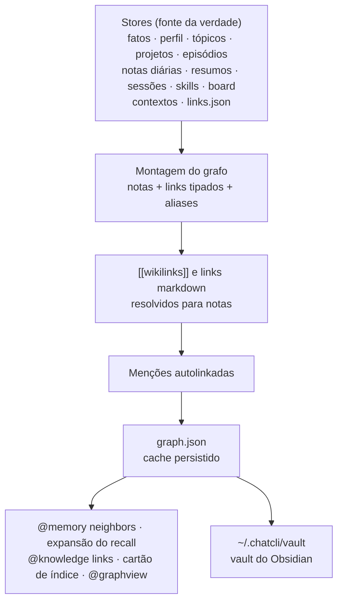

O ChatCLI guarda o que sabe nos próprios stores: fatos, o perfil, tópicos, projetos, a linha do tempo de episódios, notas diárias e resumos, sessões salvas, skills, o board de trabalho e os contextos do `/context`. O **grafo de conhecimento** liga tudo isso do jeito que um vault do Obsidian faz. Cada item é uma **nota**, as notas apontam umas para as outras por **links tipados e direcionados**, toda nota tem **backlinks** e `[[wikilinks]]` funcionam em qualquer lugar.

O grafo serve a três coisas:

- **O modelo navega por ele** com [`@memory neighbors`](#memory-neighbors-o-grafo-local) (e a seção `## Related (graph)` de todo `@memory recall`), [`@memory link`](#links-explícitos) e [`@knowledge links`](#documentos-dos-contextos).
- **Você o abre como um vault do Obsidian**: o ChatCLI mantém uma nota Markdown por nota do grafo, em sincronia, em `~/.chatcli/vault`. Veja [O vault](#o-vault-do-obsidian).
- **O cartão de índice de cada turno** (contagem por tipo mais os hubs) diz ao modelo o que existe, para ele saber o que buscar.



Os stores continuam sendo a fonte da verdade: cifrados em repouso, deduplicados e seguros entre processos. O grafo é derivado deles e fica em cache em `~/.chatcli/memory/graph.json`; o vault é uma projeção do grafo. A única entrada do grafo que não é derivada é o `links.json`, que guarda os links que você cria de propósito.

## Notas

| Tipo | Id do nó | O que é | Aliases (outros nomes que um `[[link]]` pode usar) |
|---|---|---|---|
| `fact` | `fact:<id>` | Um fato de longo prazo (o id é um hash do conteúdo) | — |
| `topic` | `topic:<nome>` | Um assunto recorrente com seu resumo contínuo | — |
| `project` | `project:<nome>` | Um projeto acompanhado | o nome base do caminho |
| `profile` | `profile:user` | Você | `user` |
| `episode` | `episode:<id>` | Uma unidade de trabalho datada (os 300 mais recentes) | — |
| `note` | `note:daily:<AAAA-MM-DD>`, `note:weekly:<AAAA-Wss>`, `note:monthly:<AAAA-MM>` | Uma nota diária ou um resumo semanal/mensal | a data ou o rótulo do período (`2026-10-24`, `2026-W43`, `2026-10`) |
| `session` | `session:<nome>` | Uma conversa salva (as 50 mais recentes) | o nome da sessão, quando o título é outro |
| `skill` | `skill:<nome>` | Uma skill instalada | — |
| `card` | `card:<id>` | Um card do board (a coluna vai no título) | o título do card |
| `kbcontext` | `kb:<id>` | Um contexto do `/context` no modo `knowledge` | — |
| `context` | `ctx:<id>` | Um contexto do `/context` em qualquer outro modo | — |
| `doc` | `doc:<id do contexto>:<origem>` | Um documento de um contexto | o nome do arquivo sem extensão |
| `tag` | `tag:<rótulo>` | Uma tag, uma categoria de fato, uma tecnologia, um gatilho de skill, um responsável | — |

Tags são cola: ligam as notas que as compartilham, mas nunca aparecem como notas relacionadas. No vault elas viram `tags` do front matter, não notas.

## Links

Um link tem direção (a nota que o escreve aponta para o alvo), uma **relação** e uma **origem**.

| Relação | De → para | Peso |
|---|---|---|
| `tagged` | fato, contexto → tag | 1 |
| `category` | fato → tag da sua categoria | 0,5 |
| `in_project` | fato → projeto (pelo caminho de origem); episódio → projeto; sessão → projeto (pelo nome) | 2 · 2 · 1,5 |
| `about` | tópico → fato | 2 |
| `uses` | projeto → tag de tecnologia | 1 |
| `has` | perfil → tag de skill ou meta | 1 |
| `same_day` | episódio → fato aprendido naquele dia no projeto; sessão → episódio; nota diária → episódio e → fato daquele dia (até 20) | 1 |
| `summarizes` | resumo semanal → notas diárias da semana; resumo mensal → semanais do mês | 1 |
| `part_of` | documento → seu contexto | 1 |
| `links_to` | um `[[wikilink]]` escrito em qualquer nota; um link markdown entre documentos | 1,5 |
| `mentions` | uma menção autolinkada (veja abaixo) | 1 |
| `triggered_by` | skill → tópico de um gatilho; skill → tag do gatilho | 1 · 0,5 |
| `assigned` | card → tag do responsável | 1 |
| qualquer nome | um link explícito criado por você | 2 |

| Origem | Significado |
|---|---|
| `structural` | Uma relação que um store já registra |
| `wikilink` | Um `[[wikilink]]` no texto de uma nota |
| `markdown` | Um link markdown relativo entre documentos |
| `mention` | Uma menção autolinkada |
| `user` | Um link explícito criado com `@memory link` ou `/memory link` |

Os pesos de todas as relações que o grafo já tinha antes dos links tipados continuam iguais, então o recall ranqueia exatamente como antes; os links tipados acrescentam direção, motivo e conexões novas por cima.

### Wikilinks e resolução de nomes

`[[alvo]]`, `[[alvo|rótulo]]`, `[[alvo#seção]]`, `[[alvo^bloco]]` e embeds (`![[alvo]]`) são links onde quer que sejam escritos: num fato que você pediu ao ChatCLI para lembrar, no resumo de um tópico, num episódio, numa nota diária, num card, num documento. O alvo resolve para uma nota por:

1. o id exato do nó (`topic:auth`);
2. um título ou alias, comparados sem acentos, sem diferenciar maiúsculas e tratando espaço, `-` e `_` como iguais (`[[Configuração do servidor]]` = `[[configuracao-do_servidor]]`).

Quando várias notas têm o mesmo nome, vence o tipo mais específico: projeto, depois tópico, depois contexto, skill, documento, perfil, nota do diário e sessão, card, episódio, fato, tag. Um alvo que não nomeia nada não é erro; o link aparece assim que a nota existir.

### Menções autolinkadas

O texto se liga sozinho. Quando o título ou um alias de um projeto, tópico, skill ou contexto aparece no texto de um fato, tópico, episódio, projeto, card ou nota do diário, essa nota ganha um link `mentions` para ele (as "menções não linkadas" do Obsidian, resolvidas automaticamente). As regras mantêm a precisão:

- o nome precisa aparecer como palavras inteiras (`Orbital` não casa com `Orbitals`);
- nomes com menos de 3 caracteres, nomes só numéricos e palavras únicas com menos de 4 caracteres ou genéricas demais (`user`, `project`, `test`, `code`, `dados`, `projeto`…) não são autolinkados;
- uma menção nunca repete um link que as duas notas já têm;
- no máximo 8 menções por nota; numa mesma posição vence o nome mais longo (`Kubernetes operator` antes de `Kubernetes`).

Documentos e tags não são alvos de menção: nomes de arquivo e palavras de tag são genéricos demais para achar em texto corrido com segurança. Eles continuam se ligando por wikilinks, tags e links explícitos.

## Links explícitos

Algumas relações só existem na sua cabeça: "este gotcha é sobre aquele projeto", "este documento explica aquele tópico". Crie o link e elas passam a ser lembradas a partir de qualquer uma das notas.

<Tabs>
  <Tab title="O modelo (@memory)">
    ```text
    <tool_call name="@memory" args='{"cmd":"link","args":{"from":"3f9a1c02","to":"Orbital","rel":"about"}}' />
    <tool_call name="@memory" args='{"cmd":"link","args":{"from":"[[Setup]]","to":"topic:telemetry security","rel":"explains","note":"a seção de TLS"}}' />
    <tool_call name="@memory" args='{"cmd":"unlink","args":{"from":"3f9a1c02","to":"Orbital"}}' />
    ```
    `from`/`to` também aceitam `source`/`target`, e `rel` também `relation`; `relate`, `connect` e `disconnect` funcionam como nomes de subcomando. `link` e `unlink` alteram a memória, então passam pela política de confirmação, como o `remember`.
  </Tab>
  <Tab title="Você (/memory)">
    ```bash
    /memory link telemetry security -> Orbital --rel about --note mantém as notas do gateway juntas
    /memory link "Ingest gateway" "Orbital"
    /memory unlink telemetry security -> Orbital
    /memory links Orbital
    ```
    A seta também pode ser `→`. `/memory links <nota>` mostra a mesma visão do `@memory neighbors`. O argumento de nota completa com os ids das notas-hub do grafo.
  </Tab>
</Tabs>

Uma referência de nota pode ser: um id de nó, um id ou prefixo de id de fato como o `@memory list` mostra, um título ou alias, um `[[wikilink]]`, ou texto livre que nomeie exatamente uma nota. Uma referência que pode significar várias notas é recusada com os candidatos e seus ids, então um link nunca é criado para a nota errada.

A relação é um nome livre guardado como slug (`Depends On` → `depends_on`, padrão `related`); palavras comuns caem nas relações embutidas (`mention` → `mentions`, `references` → `links_to`, `belongs_to` → `part_of`, `project` → `in_project`).

Os links explícitos ficam em `~/.chatcli/memory/links.json`:

- cifrado em repouso, gravado de forma atômica, mesclado entre processos sob lock de arquivo, em quarentena se corromper e somente leitura quando cifrado com uma chave que o processo não tem — como todo store da memória;
- uma remoção é um tombstone guardado por 30 dias, então outro processo nunca traz de volta um link removido;
- um link criado para um fato que depois é **substituído** passa a seguir o fato mais novo automaticamente, e a compactação da memória move os links dos fatos que reescreve para o fato consolidado que os reafirma;
- um link cuja nota sumiu **dos stores** é mantido por 30 dias (um contexto recriado, um fato reaprendido) e depois descartado pela compactação da memória. Notas que só ficaram fora dos limites de tamanho do grafo (sessões mais antigas, episódios antigos, documentos além do limite) continuam existindo e nunca perdem seus links; tags e ids desconhecidos nunca são coletados;
- `/memory export` e `/memory import` levam os links; ids de fato são hashes do conteúdo, então os links sobrevivem à mudança da memória para outra máquina;
- no máximo 10.000 links; a nota de um link é uma linha de no máximo 280 bytes (notas maiores são cortadas com reticências).

O `unlink` remove só links explícitos. Um link que vem dos próprios dados (uma tag em comum, o projeto do fato, um wikilink, uma menção) é informado com sua relação e origem: altere os dados para mudá-lo.

## Documentos dos contextos

Um contexto não é um bloco opaco no grafo: cada **documento** dentro dele é uma nota. Os chunks de um corpus do `@docs-flatten` voltam a formar o documento de onde vieram.

- **Título**: o `title` do front matter, senão o primeiro heading, senão o nome do arquivo. **Resumo**: a primeira linha de texto (até 200 caracteres).
- **Links markdown** entre documentos viram links `links_to`: caminhos relativos resolvem a partir da pasta do próprio documento; `#âncoras` e `?queries` são ignoradas; a extensão é opcional (`.md`, `.mdx`, `.markdown`, `.html`); um link para uma pasta cai no `README` ou `index` dela; um link absoluto do site (`/guide/setup`) resolve a partir da raiz do corpus ou por um sufixo de caminho único. Links para URLs, `mailto:`, `data:` e âncoras na própria página não são links de documento.
- **Wikilinks** num documento resolvem primeiro contra os títulos e nomes de arquivo dos documentos do mesmo contexto, depois contra o vault inteiro: uma página pode linkar um tópico ou projeto da memória.
- **Limites**: até 2.000 documentos por contexto e 6.000 no grafo inteiro (os contextos que você criou primeiro mantêm os seus) e até 64 links por documento. Todo documento continua acessível pela busca de qualquer forma.
- Caminhos do Windows são tratados: contextos escaneados guardam `\` nos caminhos, os links dentro dos documentos usam `/`.

O grafo de documentos é derivado uma vez por revisão do contexto e memoizado, então não custa nada nos rebuilds seguintes.

O modelo segue esses links com o `@knowledge`:

```text
<tool_call name="@knowledge" args='{"cmd":"links","args":{"source":"docs/gateway.md"}}' />
```

```text
handbook :: docs/guide/gateway.md — "Ingest gateway"
  · Terminates mTLS.
→ links to (1):
  - docs/guide/setup.md — "Getting set up"
← linked from (2):
  - docs/guide/index.md — "Guide index"
  - docs/guide/setup.md — "Getting set up"
[[wikilinks]] to notes outside this base (see @memory neighbors): Orbital
```

Um id de chunk citado (`docs/gateway.md#0002`) também funciona como `source`. `backlinks`, `related` e `see_also` são aceitos como nome do subcomando. Todo `@knowledge search` também termina com até 6 **documentos ligados** aos primeiros resultados que não estão entre eles:

```text
Linked documents (not in the results above; read with get, or links for more):
- handbook :: docs/guide/setup.md (linked from docs/guide/gateway.md)
- handbook :: docs/guide/index.md (links to docs/guide/gateway.md)
```

## `@memory neighbors`: o grafo local

O `neighbors` mostra uma nota e o que está em volta dela, até dois saltos, com a relação de cada vizinho direto: `→` para links que a nota escreve, `←` para backlinks.

```text
Local graph of "orbital" (project:orbital):
Connected (→ links it writes, ← backlinks):
  - [fact] Orbital streams telemetry over gRPC with mTLS  (← in_project)
  - [card] [doing] rotate Orbital certificates — before the deploy window  (← mentions)
  - [doc] Ingest gateway — Terminates mTLS. See [[Setup]] and [[Orbital]].  (← links_to)
  - [topic] telemetry security — mTLS between collectors and the ingest gateway
```

A consulta pode ser um id de nó, um título, um alias ou um `[[wikilink]]`, que nomeiam uma nota exatamente; outro texto cai na melhor correspondência por palavra-chave. O `@memory map` dá a visão geral: contagem de nós por tipo e as notas-hub. Os nomes antigos `links`, `backlinks` e `related` continuam significando `neighbors`.

**O recall usa o grafo.** Os principais fatos de todo `@memory recall` (e da injeção no modo `full`) são expandidos um salto, e as notas estruturalmente vizinhas que o ranking não pegou entram numa seção `## Related (graph)`; o auto-recall proativo acrescenta uma linha `Related (graph):`. Veja [Bootstrap e Memória](/pt/context/bootstrap-memory#grafo-de-conhecimento-memory-neighbors--map).

**O cartão de índice** injetado a cada turno lista a contagem de nós por tipo e até 8 hubs. Documentos são contados, mas nunca aparecem como hubs, para que um corpus muito interligado não tire do cartão os seus próprios projetos e tópicos.

**`@graphview`** com `source=knowledge` desenha o grafo inteiro; selecionar uma aresta mostra as relações por trás dela (`about · mentions`). Veja [Grafo interativo](/pt/tools/graphview).

## O vault do Obsidian

O ChatCLI mantém o grafo como um vault compatível com o Obsidian: abra `~/.chatcli/vault` como vault no Obsidian (ou leia em qualquer editor ou com git).

```text
~/.chatcli/vault/
|-- Home.md                                   # mapa de conteúdo: o cartão de índice e depois cada perfil, projeto, tópico, contexto, skill, card, nota do diário e sessão
|-- Profile/<nome>.md
|-- Projects/<nome>.md
|-- Topics/<nome>.md
|-- Facts/<categoria>/<título> (<id>).md
|-- Episodes/<ano>/<data> <título> (<id>).md
|-- Journal/Daily/2026-10-24.md               # os nomes que o plugin de notas diárias do Obsidian usa
|-- Journal/Weekly/2026-W43.md
|-- Journal/Monthly/2026-10.md
|-- Sessions/<nome>.md
|-- Skills/<nome>.md
|-- Board/<coluna>/<título> (<id>).md
|-- Contexts/<contexto>/<contexto>.md         # nota da pasta: o contexto e a lista dos seus documentos
|-- Contexts/<contexto>/<caminho de cada documento>  # um documento .md mantém o nome, os outros ganham .md no fim
+-- .chatcli/manifest.json                    # o que o vault gravou (o Obsidian ignora pastas com ponto)
```

Toda nota tem front matter YAML e uma seção `## Links`:

```markdown
---
chatcli_id: fact:ab37259d1cbc0a08a73db347
kind: fact
aliases:
  - Orbital streams telemetry over gRPC with mTLS
tags:
  - grpc
  - security
category: architecture
confidence: "0.70"
provenance: extraction
source_project: /repo/orbital
created: 2026-10-24T12:00:00Z
last_accessed: 2026-10-24T12:00:00Z
---

# Orbital streams telemetry over gRPC with mTLS

Orbital streams telemetry over gRPC with mTLS

## Links

- in project → [[Projects/orbital]]
```

| Tipo | Campos do front matter além de `chatcli_id`, `kind`, `aliases`, `tags` |
|---|---|
| fato | `category`, `confidence`, `provenance`, `source_project`, `created`, `last_accessed` |
| tópico | `mentions`, `first_seen`, `last_seen` |
| projeto | `path`, `status`, `last_active`, `technologies` |
| episódio | `date`, `project`, `source` |
| card | `column`, `assignee`, `created`, `updated` |
| contexto | `mode`, `files`, `updated` |
| documento | `source`, `context` |

- **Links** lista os links de saída da nota agrupados por relação, como wikilinks com o caminho exato da nota (`[[Pasta/Nota|Título]]`); o Obsidian calcula os backlinks. Um link criado por você aparece com `· linked by you` e a nota dele.
- **Wikilinks dentro do texto** (um fato, um documento, uma nota diária) são reescritos para o caminho exato da nota a que o grafo os resolve, mantendo `#seção` e `|rótulo`, então funcionam no Obsidian mesmo quando o alvo é um alias, um título diferente do nome do arquivo ou uma nota em outra pasta. Blocos de código cercados não são alterados; um alvo que não nomeia nada fica como foi escrito.
- **Documentos** levam o conteúdo completo (até 1 MiB por nota) depois de uma linha `> Source:`, com segredos mascarados pelo mesmo redator usado no caminho do modelo; código-fonte aparece num bloco cercado e nunca é reescrito (links e `[[…]]` só são lidos em Markdown, fora de blocos de código). O caminho de um documento é mantido relativo à pasta que os documentos do contexto compartilham. Notas do diário levam o texto completo; o perfil lista os seus campos.

### Sincronização

O vault sincroniza em background: alguns segundos (5 s sem mudanças, no máximo 60 s) depois que a memória muda, e 10 s depois de iniciar. É incremental. Uma nota só é regravada quando o conteúdo mudou, e um documento nem é relido a menos que o contexto ou os links dele tenham mudado; num store sintético de cerca de 2.800 notas, o primeiro sync levou cerca de 2,1 s e um sync sem nada a gravar, cerca de 0,4 s.

Dá para trabalhar no vault com segurança:

- **Suas edições são preservadas.** Uma nota que você alterou não é sobrescrita nem removida; o `/memory vault` a lista como preservada. `/memory vault sync --force` regenera as notas do próprio ChatCLI.
- **Arquivos que o ChatCLI não gravou nunca são tocados**, nem com `--force`: acrescente à vontade suas próprias notas, canvases e anexos.
- Uma nota que o ChatCLI não produz mais só é removida se você não a editou, e as pastas vazias vão junto.
- As escritas são atômicas; arquivos `0600` e pastas `0700`. Um sync interrompido pelo encerramento não remove nada, e um manifesto corrompido faz o próximo sync manter todos os arquivos.
- Os nomes de arquivo são portáveis: caracteres que o Windows, o Obsidian ou a sintaxe de links rejeitam são substituídos, os nomes têm tamanho limitado e duas notas cujos nomes diferem só em maiúsculas ganham arquivos distintos.

<Warning>
O vault fica em **texto claro** mesmo com a [criptografia em repouso](/pt/security/encryption-at-rest) ligada: ele existe para ser lido num editor. Campos do perfil marcados como sensíveis (`sensitive_mark`), ou cuja chave os marca como privados (finanças, documentos, contato, saúde, família…), aparecem como `‹private›`, um nome de perfil privado vira `user` em todo lugar (nome do arquivo, título, links, Home), listas privadas de skills e metas não geram tags, segredos em documentos e notas do diário saem mascarados, e transcrições de sessão nunca entram nele (as notas de sessão levam só o título e os links). No gateway de chat com isolamento por remetente, cada remetente tem o próprio vault no próprio diretório de estado (`CHATCLI_MEMORY_VAULT_DIR` só realoca o principal), e syncs do mesmo vault por vários processos são serializados com um lock de arquivo. Desligue com `CHATCLI_MEMORY_VAULT=false`; um vault existente fica onde está, para você apagar.
</Warning>

### Comandos e configuração

```bash
/memory vault                # onde ele está e como foi a última sincronização
/memory vault sync           # sincroniza agora (funciona mesmo com a geração automática desligada)
/memory vault sync --force   # regenera também as notas que você editou
/memory vault path           # mostra a pasta, para abrir no Obsidian
```

| Variável | Padrão | Descrição |
|---|---|---|
| `CHATCLI_MEMORY_VAULT` | `true` | Mantém o vault em sincronia em background (`false`, `off`, `0`, `no` desligam) |
| `CHATCLI_MEMORY_VAULT_DIR` | `~/.chatcli/vault` | Local do vault (um `~` no início é expandido); por padrão `vault` ao lado do diretório da memória, então dentro do `CHATCLI_STATE_DIR` quando ele está definido. Remetentes do gateway com isolamento usam sempre o próprio diretório de estado |
| `CHATCLI_MEMORY_GRAPH` | `true` | Cache persistido do grafo e expansão do recall (veja [Bootstrap e Memória](/pt/context/bootstrap-memory)) |
| `CHATCLI_GRAPH_INDEX` | `true` | Cartão de índice de cada turno |

O `/config memory` mostra a contagem de links explícitos, as duas variáveis do vault e a última sincronização. O vault é gerado em todos os modos, inclusive no server. No Kubernetes, o Helm chart tem `memory.vault.enabled` e `memory.vault.dir`, e o operator tem `spec.features.memory.vault`; no caminho padrão o vault não fica num volume persistente, então é reconstruído a cada início.

## Atualizando

Nada a fazer. Os stores mantêm o formato e nada é convertido. Um `graph.json` gravado por uma versão anterior (schema 1) é descartado no primeiro início e reconstruído a partir dos stores, agora com links tipados; o `links.json` e o vault começam vazios e se preenchem sozinhos. Um teste monta a mesma memória com o builder anterior do grafo e com o novo e confere que toda nota e todo link que os usuários tinham antes continuam lá, com pelo menos o mesmo peso.

No mesmo store sintético (cerca de 2.800 notas e 7.900 links, 2.000 deles documentos), montar o grafo levou cerca de 28 ms na primeira vez e 8 ms nos rebuilds seguintes, e o `graph.json` ficou com cerca de 3,2 MB; o arquivo guarda os links tipados e só a adjacência que eles não explicam.
