Um assistente com quem você trabalha há meses precisa lembrar do que você contou: a decisão de três semanas atrás, o número que você corrigiu na terça passada, a cidade para onde você se mudou, e também quando dizer "você nunca me contou isso". O **LongMemEval** mede exatamente isso, e rodamos as 500 perguntas dele no chatcli.

<CardGroup cols={4}>
  <Card title="94,6%" icon="flask">
    das 260 perguntas de validação, nenhuma lida durante o ajuste do chatcli (246 corretas)
  </Card>
  <Card title="96,2%" icon="bullseye">
    481 de 500 perguntas respondidas corretamente na v1.232.0, contra 90,8% na primeira rodada
  </Card>
  <Card title="470 / 470" icon="magnifying-glass">
    perguntas em que a busca do chatcli trouxe a evidência
  </Card>
  <Card title="19 s · US$ 0,10" icon="gauge-high">
    tempo mediano e custo médio por pergunta
  </Card>
</CardGroup>

<Frame>
  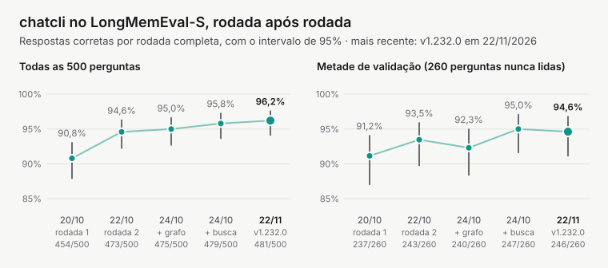
  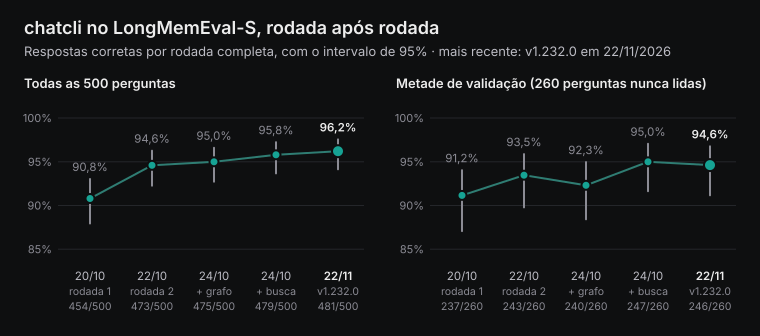
</Frame>

Os números acima são da [checagem mensal](#checagem-mensal) mais recente: chatcli v1.232.0, rodado em 22/11/2026.

<Card title="A história por trás dos números" icon="linkedin" href="https://www.linkedin.com/pulse/fiz-500-perguntas-%C3%A0-mem%C3%B3ria-do-meu-agente-ele-acertou-edilson-freitas-fyqff/">
  O artigo no LinkedIn mostra as 500 perguntas, as falhas reais, os bugs que a rodada encontrou e o que mudou depois.
</Card>

---

## O que é o LongMemEval

O [LongMemEval](https://github.com/xiaowu0162/LongMemEval) é um benchmark do artigo *LongMemEval: Benchmarking Chat Assistants on Long-Term Interactive Memory* (Di Wu, Hongwei Wang, Wenhao Yu, Yuwei Zhang, Kai-Wei Chang e Dong Yu, **ICLR 2025**). São 500 perguntas curadas à mão. Cada pergunta vem com o próprio histórico de sessões de chat, com data e hora. Na variante **S**, esse histórico tem cerca de 115 mil tokens, umas 40 a 50 sessões de conversa do dia a dia, e a evidência da resposta está escondida em algum lugar ali dentro.

As perguntas testam cinco habilidades:

| Habilidade | O que pede | Exemplo do dataset |
|---|---|---|
| **Extração de informação** | lembrar um detalhe que o usuário ou o assistente disse | "What degree did I graduate with?" |
| **Raciocínio entre sessões** | juntar fatos espalhados por várias sessões | "How many MCU films did I watch in the last 3 months?" |
| **Raciocínio temporal** | raciocinar sobre quando as coisas aconteceram | "How many weeks ago did I start using Ibotta?" |
| **Fatos atualizados** | usar o valor mais recente quando um fato mudou | "How many pre-1920 coins do I have?" (37, depois 38) |
| **Recusa** | admitir quando o histórico não tem a resposta | "At which university did I present a poster for my undergrad course research project?" (nunca foi dito) |

### Por que importa

- **É difícil de propósito.** O artigo relata que assistentes comerciais e LLMs de contexto longo perdem 30% de acurácia ao memorizar informação ao longo de interações contínuas. Uma janela de contexto maior, sozinha, não resolve.
- **Testa a falha que o usuário de fato vê.** Um assistente que esquece uma correção, mistura duas viagens ou inventa uma resposta que nunca recebeu perde a confiança rápido. O LongMemEval mede cada um desses casos separadamente.
- **É reproduzível.** O dataset, as perguntas, as respostas de referência e os prompts do juiz são públicos (MIT), então qualquer pessoa pode rodar de novo e comparar.

---

## Como o chatcli foi testado

O objetivo era testar o chatcli do jeito que você o usa, não testar o modelo. **Nada foi colado no prompt.** O histórico de cada pergunta virou sessões salvas do próprio chatcli, e ele teve que achar a evidência com as ferramentas de memória dele.

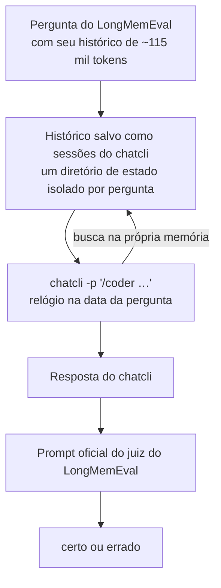

<Steps>
  <Step title="Uma instalação isolada por pergunta">
    Um [`CHATCLI_STATE_DIR`](/pt/reference/environment-variables) novo guarda o histórico da pergunta como sessões salvas; a data de modificação de cada arquivo é a data da sessão. Sua memória real nunca se mistura, e seu login é reaproveitado no lugar via `CHATCLI_AUTH_DIR`.
  </Step>
  <Step title="O relógio no dia da pergunta">
    O [`CHATCLI_NOW`](/pt/reference/environment-variables) é a data da pergunta, então "há duas semanas" significa duas semanas antes da pergunta, não antes da execução.
  </Step>
  <Step title="O chatcli responde sozinho">
    `chatcli -p "/coder …"` com Claude Sonnet 5.5 e uma única instrução neutra: responda pelas nossas conversas anteriores e diga se elas não têm a resposta. O chatcli decide quais tools chamar.
  </Step>
  <Step title="O juiz oficial">
    Cada resposta é avaliada com os prompts oficiais de verificação do LongMemEval, sem alteração, rodando com Claude Sonnet 5.5.
  </Step>
</Steps>

---

## Checagem mensal

O chatcli muda toda semana, e uma mudança no prompt, nas ferramentas ou na busca pode custar memória sem que nenhum teste falhe. Por isso o benchmark inteiro é rodado de novo **uma vez por mês na release mais recente**, com o mesmo dataset, prompts do juiz, modelo, driver e divisão. A pergunta que ele responde é "pioramos?", não "melhoramos?".

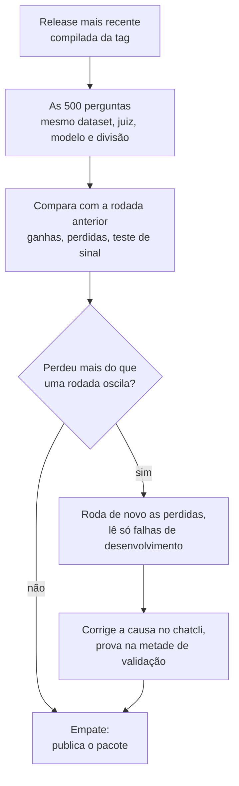

| Mês | chatcli | Todas as 500 | Validação, 260 | Contra a rodada anterior | Veredito |
|---|---|---|---|---|---|
| 11/2026 | v1.232.0 | 481 = 96,2% | 246 = 94,6% | 10 ganhas, 8 perdidas (p = 0,81) | **empate** |
| 10/2026 (referência) | main + busca de sessões | 479 = 95,8% | 247 = 95,0% | 11 ganhas, 7 perdidas (p = 0,48) | melhora na validação |

**Como ler uma checagem.** Com o mesmo binário, uma rodada completa oscila uns ±4 perguntas: nas três primeiras rodadas, 53 das 500 perguntas viraram pelo menos uma vez. Uma perda maior que isso, confirmada pelo teste de sinal, é regressão e vai para investigação. Qualquer coisa menor é empate, para o lado que for.

<Frame>
  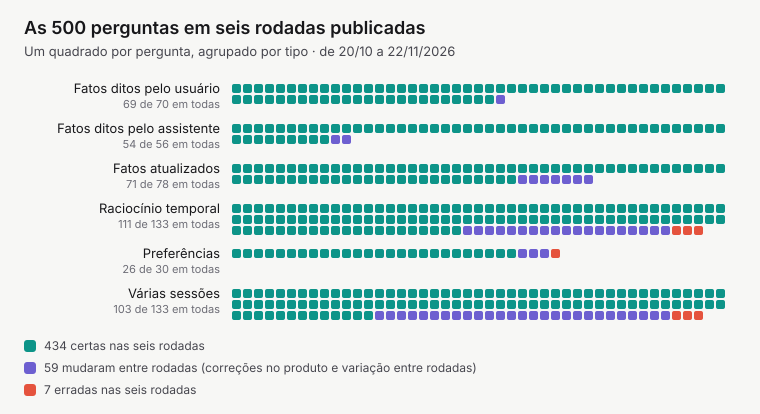
  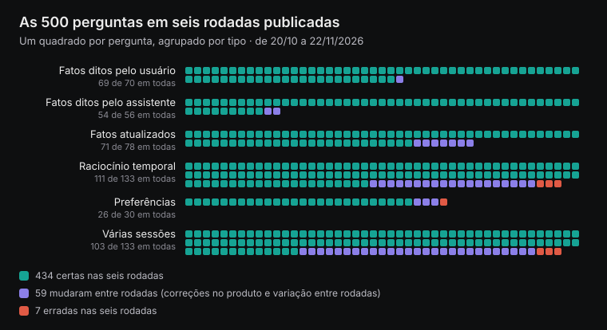
</Frame>

Nas seis rodadas publicadas, **434 das 500 perguntas foram respondidas corretamente todas as vezes**. 59 mudaram entre rodadas: algumas foram corrigidas pelas mudanças de outubro no produto, as outras passam numa rodada e falham na seguinte. 7 erraram todas as vezes. É nessas 66 perguntas que o número de um mês se mexe; as outras 434 não se mexeram nenhuma vez.

<Frame>
  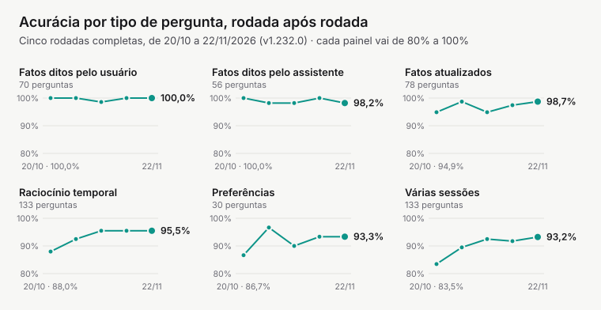
  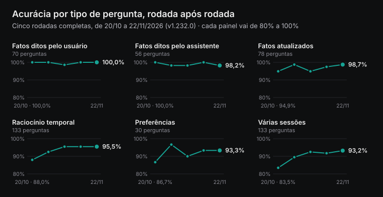
</Frame>

### Novembro de 2026: v1.232.0

A primeira checagem mensal rodou em 22/11/2026 na release v1.232.0, que traz tudo o que foi mergeado desde a referência de outubro (releases v1.225.0 a v1.232.0). **Resultado: empate com outubro.**

| | 24/10/2026 + busca de sessões | **22/11/2026, v1.232.0** |
|---|---|---|
| Todas as 500 perguntas | 479 = 95,8% (93,7–97,2%) | **481 = 96,2%** (94,1–97,6%) |
| Validação, 260 | 247 = 95,0% (91,6–97,1%) | **246 = 94,6%** (91,2–96,8%) |
| Validação sem as 3 perguntas lidas em 24/10/2026 | 245/257 | 244/257 |
| Desenvolvimento, 240 | 232 = 96,7% | 235 = 97,9% |
| Evidência trazida ao modelo | 470 / 470 | 470 / 470 |
| Abstenção (sem resposta, 30) | 28 | 29 |
| Custo por pergunta | US$ 0,100 | US$ 0,102 |
| Tool calls por pergunta | 3,4 | 3,5 |
| Tempo mediano por pergunta | 20,2 s | 19,1 s |

- **Duas respostas certas a mais não são melhora.** Contra outubro a rodada ganhou 10 perguntas e perdeu 8 (teste de sinal p = 0,81). Na metade de validação ganhou 5 e perdeu 6 (p = 1,00). As duas diferenças cabem no que uma rodada oscila.
- **A busca não regrediu.** A sessão com a resposta chegou ao modelo nas 470 perguntas com resposta, e em todas as 8 que foram perdidas.
- **As perguntas perdidas foram rodadas de novo.** Com o mesmo binário, 5 das 8 passaram. As 3 que falharam duas vezes já tinham falhado em 3 das 5 rodadas publicadas antes: eram instáveis antes desta release.
- **Custo e esforço não mudaram:** US$ 0,102 por pergunta contra US$ 0,100, 3,5 tool calls contra 3,4, 78,6 mil tokens de entrada contra 78,0 mil. As 500 execuções terminaram sem erro, em 48 minutos com 4 em paralelo (US$ 48,92 respondendo, US$ 1,84 julgando).

<Frame>
  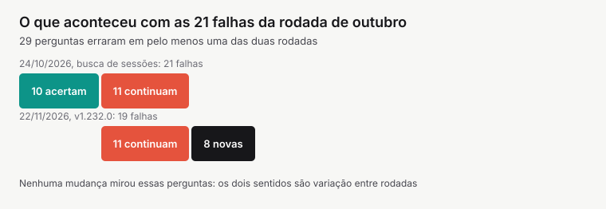
  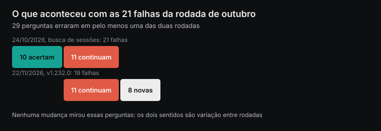
</Frame>

| Tipo de pergunta | 24/10/2026 + busca de sessões | 22/11/2026, v1.232.0 | das quais validação |
|---|---|---|---|
| Fatos ditos pelo usuário | 70/70 | 70/70 | 34/34 |
| Fatos ditos pelo assistente | 56/56 | 55/56 | 27/28 |
| Fatos atualizados | 76/78 | 77/78 | 39/40 |
| Raciocínio temporal | 127/133 | 127/133 | 63/67 |
| Preferências | 28/30 | 28/30 | 16/18 |
| Várias sessões | 122/133 | 124/133 | 67/73 |
| Abstenção (entre os tipos) | 28/30 | 29/30 | 12/13 |

**Onde ainda falha.** Das 19 falhas, 18 são raciocínio com a evidência na frente do modelo e 1 respondeu uma pergunta que o histórico não responde. 9 são perguntas de várias sessões e 6 temporais. 11 das 19 também erraram em outubro.

O chatcli usou `@session get` 888 vezes, `@session search` 644 vezes, `@memory recall` 138 vezes e o [`@date`](/pt/tools/date) 64 vezes em 54 perguntas. Em 56 perguntas ele limitou as buscas por data por conta própria (63 chamadas). Ele nunca foi à web.

---

## Mesmo modelo, outro harness: Claude Code

O modelo não responde sozinho. Um agente decide como o histórico é guardado, o que uma busca devolve e quanto disso chega ao modelo, e isso é o **harness**. Para ver quanto o harness pesa, as mesmas 500 perguntas foram rodadas em 22/11/2026 pelo **Claude Code 2.1.330**, com o mesmo modelo respondendo (Claude Sonnet 5.5), o mesmo juiz e o mesmo dataset da rodada do chatcli v1.232.0 daquele dia.

<CardGroup cols={3}>
  <Card title="96,2% e 92,6%" icon="scale-balanced">
    chatcli 481 de 500, Claude Code 463 de 500, com o mesmo modelo respondendo
  </Card>
  <Card title="25 a 7" icon="code-compare">
    perguntas que só o chatcli acertou contra as que só o Claude Code acertou (p = 0,002)
  </Card>
  <Card title="US$ 0,046 · 8 s" icon="bolt">
    Claude Code por pergunta: menos da metade do custo e do tempo do chatcli
  </Card>
</CardGroup>

<Frame>
  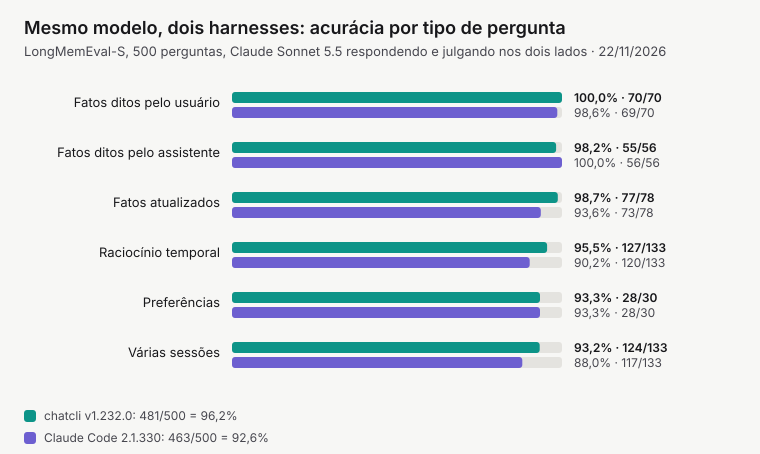
  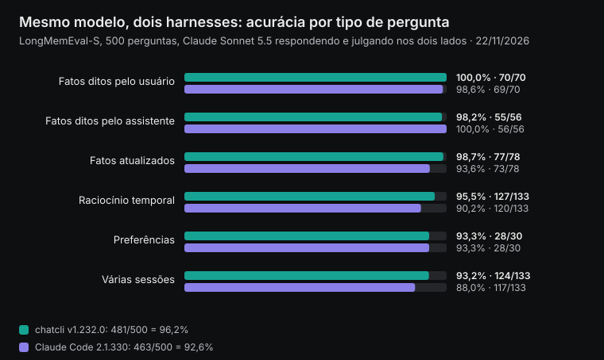
</Frame>

| | Claude Code 2.1.330 | chatcli v1.232.0 |
|---|---|---|
| Todas as 500 perguntas | 463 = 92,6% (90,0–94,6%) | **481 = 96,2%** (94,1–97,6%) |
| Validação, 260 | 238 = 91,5% (87,5–94,3%) | **246 = 94,6%** (91,2–96,8%) |
| Todas as sessões de evidência trazidas | 452 / 470 | 462 / 470 |
| Abstenção (sem resposta, 30) | 29 | 29 |
| Custo por pergunta | **US$ 0,046** | US$ 0,102 |
| Tempo mediano por pergunta | **8,1 s** | 19,1 s |
| Tokens de entrada por pergunta | 60,3 mil | 78,6 mil |
| Tool calls por pergunta | 2,0 | 3,5 |

<Frame>
  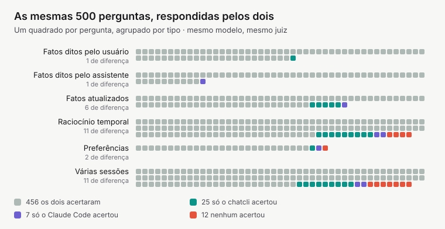
  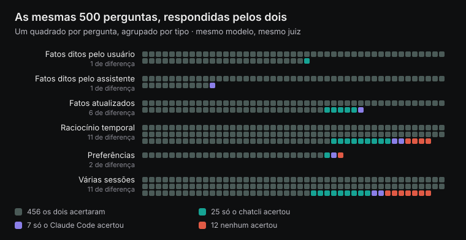
</Frame>

- **Na lembrança simples eles empatam.** Nos três tipos de sessão única os dois acertaram 153 de 156.
- **A diferença está onde a resposta fica espalhada.** Fatos atualizados, raciocínio temporal e várias sessões exigem achar e ler todas as menções: o chatcli acertou 328 dessas 344, o Claude Code 310.
- **Eles buscam de jeitos diferentes.** O Claude Code fez 885 chamadas de `Grep` e abriu um arquivo de sessão com `Read` em 57 das 500 perguntas; o resto ele respondeu pelas linhas encontradas. O chatcli fez 644 buscas e abriu sessões 888 vezes. Das 37 falhas do Claude Code, 25 são raciocínio com a evidência trazida, 5 disseram que a evidência não estava lá, 5 acharam só parte dela, 1 nunca achou e 1 respondeu uma pergunta sem resposta.
- **O Claude Code é mais barato e mais rápido,** em mais da metade nos dois.

<Frame>
  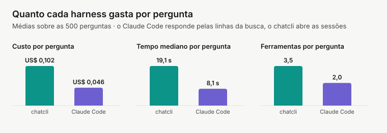
  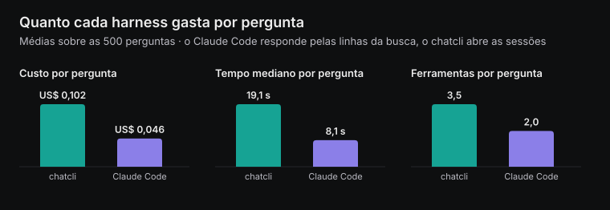
</Frame>

**O que isso diz.** Com o modelo fixo, o harness moveu o resultado em 18 perguntas de 500. Mais contexto chegando ao modelo custou mais e acertou mais; uma busca mais leve custou menos e errou as perguntas que dependem de ler tudo.

<AccordionGroup>
  <Accordion title="O que deixa esta comparação desigual" icon="scale-unbalanced">
    - **O chatcli foi ajustado neste benchmark e o Claude Code não.** As mudanças do chatcli foram desenhadas a partir da metade de desenvolvimento, então a metade de validação é a comparação mais justa: 246 contra 238, 13 perguntas a 5 (p = 0,10). A direção é a mesma, mas sozinha ela não é significativa.
    - **O Claude Code não é um produto de memória de conversas.** Ele não tem um acervo de conversas passadas para buscar. O histórico de cada pergunta foi escrito em arquivos de transcrição em `sessions/` de um diretório vazio, e o prompt diz onde eles estão. O chatcli leu as próprias sessões salvas com as próprias ferramentas.
    - **A data da pergunta.** O chatcli recebe pelo [`CHATCLI_NOW`](/pt/reference/environment-variables); para o Claude Code ela vai escrita no prompt.
    - **Um Claude Code limpo.** Rodou com `--safe-mode`: sem configurações do usuário, CLAUDE.md, plugins ou servidores MCP da máquina, sem ferramentas de web e sem sessão salva.
    - **Uma rodada de cada.** Uma rodada oscila uns ±4 perguntas; os 18 entre eles ficam bem fora disso, os 8 da metade de validação nem tanto.
    - **Os transcripts dele não foram lidos.** Os números acima são contagens sobre a rodada, não leitura de respostas individuais.
  </Accordion>
</AccordionGroup>

---

## Rodadas anteriores

Daqui para baixo a página trata das rodadas que vieram antes das checagens mensais. Cada uma está recolhida: abra para ler os resultados, o que mudou no chatcli e onde falhou.

<AccordionGroup>
  <Accordion title="Terceira rodada (24/10/2026): busca de sessões, 479 de 500" icon="clock-rotate-left">

Mais duas rodadas completas em 24/10, com o mesmo dataset, prompts do juiz, modelo e divisão. A primeira rodou a main depois do merge do [grafo de memória](/pt/context/knowledge-graph) ([#1877](https://github.com/diillson/chatcli/pull/1877)–[#1883](https://github.com/diillson/chatcli/pull/1883)), como checagem de regressão. A segunda acrescenta a [busca de sessões](/pt/context/session-search#várias-formulações-numa-chamada) do [#1887](https://github.com/diillson/chatcli/pull/1887), que aceita várias formulações da pergunta numa só chamada. **A segunda é a referência com que as [checagens mensais](#checagem-mensal) se comparam.**

<Frame>
  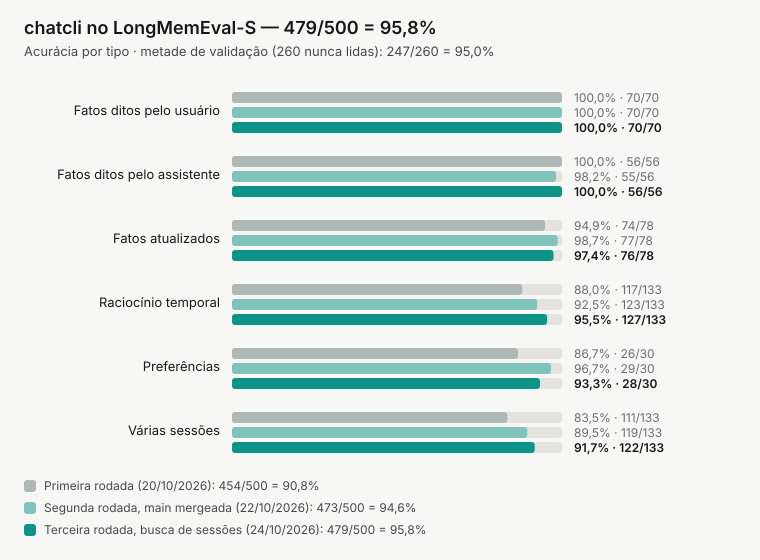
  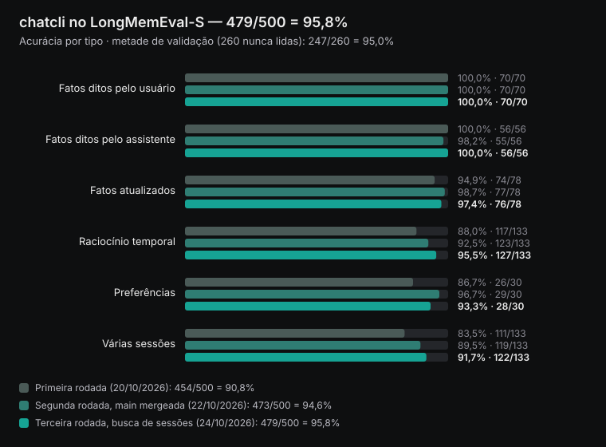
</Frame>

| | Segunda rodada, main mergeada | Main + grafo de memória | **+ busca de sessões** |
|---|---|---|---|
| Todas as 500 perguntas | 473 = 94,6% | 475 = 95,0% | **479 = 95,8%** (93,7–97,2%) |
| Validação, 260 | 243 = 93,5% | 240 = 92,3% | **247 = 95,0%** (91,6–97,1%) |
| Validação sem as 3 perguntas lidas em 24/10 | 240/257 | 240/257 | **245/257** |
| Evidência que chegou ao modelo | 470 / 470 | 469 / 470 | 470 / 470 |
| Recusa (sem resposta, 30) | 25 | 28 | 28 |
| Custo por pergunta | US$ 0,101 | US$ 0,099 | US$ 0,100 |
| Chamadas de ferramenta por pergunta | 5,0 | 4,7 | **3,4** |

<Frame>
  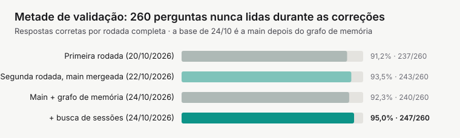
  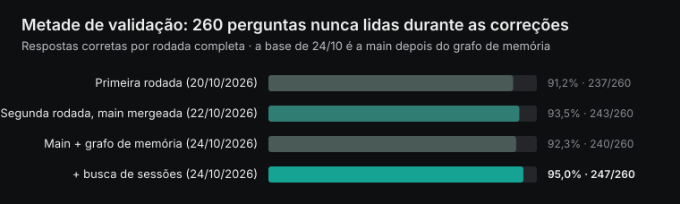
</Frame>

- **O grafo de memória não mexeu na lembrança:** 13 ganhos e 11 perdas contra a segunda rodada (p = 0,84).
- **A busca de sessões ganhou nas perguntas que ninguém leu:** de 240 para 247 na metade de validação (9 ganhos, 2 perdas, p = 0,065), e de 475 para 479 nas 500. É mais do que os ±4 que uma rodada oscila, mas os intervalos ainda se sobrepõem.
- **Não custa nada a mais.** As chamadas de ferramenta por pergunta caíram de 4,7 para 3,4, porque uma busca agora leva várias formulações, e o custo por pergunta ficou em US$ 0,100. O modelo usou isso nas 500 perguntas.
- **A metade de desenvolvimento perdeu 3 (de 235 para 232).** Em toda pergunta de desenvolvimento que passou a falhar, a sessão com a evidência estava na frente do modelo. Os erros foram de raciocínio, ou de leituras que o gabarito não compartilha, como se "got" significa encomendou ou recebeu. A busca não regrediu.
- **Uma exceção à divisão:** três falhas de validação da rodada base (`07741c45`, `6a1eabeb`, `830ce83f`) foram lidas ao checar regressão. Nenhuma mudança foi desenhada a partir delas, e a tabela também pontua a validação sem elas.

**Por que formulações.** Nas perguntas multi-sessão, 45 das 309 sessões de evidência (15%) não têm nenhuma palavra em comum com a pergunta: o usuário disse com as próprias palavras. Antes dessa mudança o chatcli as achava buscando de novo com outras palavras (3,3 buscas por pergunta nesses casos, contra 2,7). O benchmark roda sem provider de embeddings, então o ganho vem só das formulações, não da camada por significado.

| Tipo de pergunta | Segunda rodada | + busca de sessões | das quais validação |
|---|---|---|---|
| Fatos que o usuário disse | 70/70 | 70/70 | 34/34 |
| Fatos que o assistente disse | 55/56 | 56/56 | 28/28 |
| Atualizações de conhecimento | 77/78 | 76/78 | 38/40 |
| Raciocínio temporal | 123/133 | 127/133 | 65/67 |
| Preferências | 29/30 | 28/30 | 16/18 |
| Raciocínio multi-sessão | 119/133 | 122/133 | 66/73 |
| Recusa (entre os tipos) | 25/30 | 28/30 | 12/13 |

<Frame>
  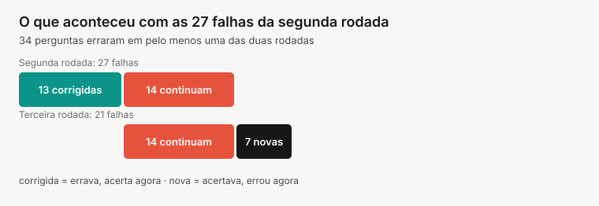
  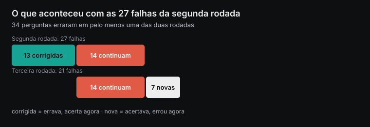
</Frame>

#### O que mudou no chatcli

As falhas da segunda rodada mostraram o mesmo padrão várias vezes: a resposta estava numa sessão que usava outras palavras que não as da pergunta, e o agente só chegava nela buscando uma segunda ou terceira vez. Medindo todas as sessões de evidência das perguntas multi-sessão, 45 de 309 (15%) não têm nenhuma palavra em comum com a pergunta.

| Mudança | O que estava errado |
|---|---|
| [Várias formulações num só `@session search`](/pt/context/session-search#várias-formulações-numa-chamada) ([#1887](https://github.com/diillson/chatcli/pull/1887)) | uma busca levava uma formulação só; as palavras do próprio usuário ("apresentei um pôster sobre minha pesquisa") só eram alcançadas se adivinhadas numa busca seguinte |
| O [cartão de memória](/pt/context/bootstrap-memory) pede várias formulações numa chamada | em contagens e listas o agente seguia uma formulação por chamada |
| [Sessões pelo significado](/pt/context/session-search#pelo-significado-embeddings) com provider de embeddings ([#1887](https://github.com/diillson/chatcli/pull/1887)) | não medido aqui: o benchmark roda sem provider de embeddings |
| O [grafo de conhecimento](/pt/context/knowledge-graph) e o vault ([#1877](https://github.com/diillson/chatcli/pull/1877)–[#1883](https://github.com/diillson/chatcli/pull/1883)) | nada; a rodada base conferiu que ele não mudou a lembrança (13 ganhos, 11 perdas, p = 0,84) |

#### O que piorou

- **A metade de desenvolvimento perdeu 3 (de 235 para 232):** 5 perdas e 2 ganhos. Nas 5, a sessão com a evidência estava na frente do modelo; as respostas seguiram leituras que o gabarito não compartilha: se "got" significa encomendou ou recebeu, se voo reservado conta como voado, quantos imóveis foram "visitados antes da proposta".
- **Por tipo contra a segunda rodada:** atualizações de conhecimento foram de 77 para 76 e preferências de 29 para 28.
- **O `@date` é usado em menos perguntas:** 50 contra 93 na rodada base, porque uma busca agora carrega mais da pergunta. Raciocínio temporal ainda subiu de 123 para 127, então isso é algo a acompanhar, não uma perda medida.

#### Onde ainda falha

Das 21 falhas, 17 são de raciocínio com a evidência na frente do modelo, 2 responderam uma pergunta que o histórico não responde, 1 disse que a evidência não estava lá e 1 achou só parte dela. 11 das 21 são perguntas multi-sessão, e quase todas são contagens e somas ("quantos", "no total", o número de páginas de dois livros): as sessões são achadas, e a soma sai errada ou deixa um item de fora. 14 das 21 também erravam na segunda rodada.

  </Accordion>
  <Accordion title="Segunda rodada (22/10/2026): correções de memória, 473 de 500" icon="clock-rotate-left">

Depois da primeira rodada, as falhas do chatcli foram lidas e as causas corrigidas no produto (listadas abaixo). As 500 perguntas rodaram de novo, com o mesmo dataset, os mesmos prompts do juiz e o mesmo modelo. Existem duas rodadas pós-mudança: uma feita na branch antes do merge (472 corretas) e a **definitiva, na main mergeada (473 corretas)**, que é a descrita aqui.

Para o número novo ser honesto, as perguntas foram separadas de antemão por uma regra fixa (`sha1(question_id)`, par ou ímpar): **240 perguntas de desenvolvimento**, cujas falhas foram lidas para desenhar as mudanças, e **260 de validação**, que ninguém olhou até a primeira rodada pós-mudança terminar.

| | Primeira rodada | Segunda rodada, main mergeada |
|---|---|---|
| Todas as 500 perguntas | 454 = 90,8% (87,9–93,0%) | **473 = 94,6%** (92,3–96,3%) |
| Validação, 260 nunca lidas | 237 = 91,2% (a primeira rodada nas mesmas 260) | **243 = 93,5%** (89,8–95,9%) |
| Evidência que chegou ao modelo | 469 / 470 | 470 / 470 |
| Recusa (sem resposta, 30) | 27 | 25 |
| Custo por pergunta | US$ 0,087 | US$ 0,101 |

<Frame>
  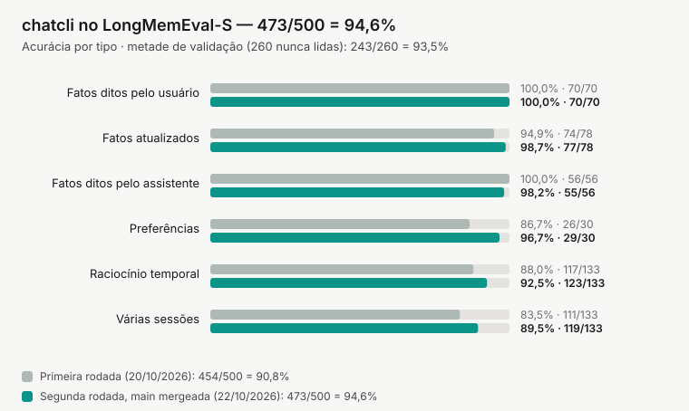
  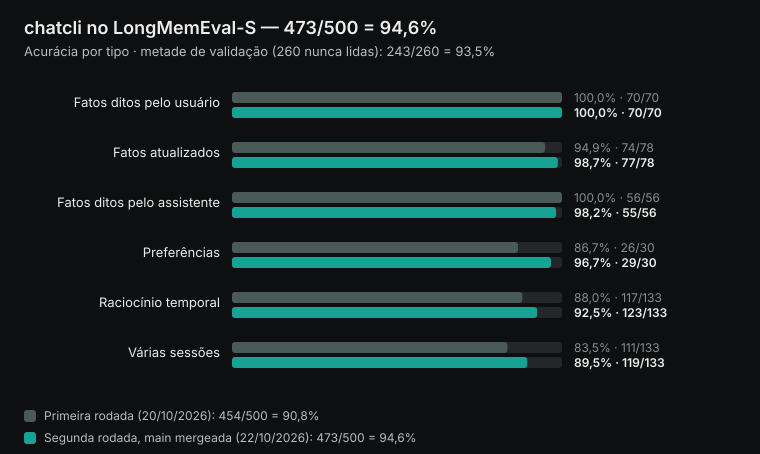
</Frame>

A linha de validação é a que vale citar. Contra a primeira rodada nas mesmas 500 perguntas, o código mergeado ganhou 27 e perdeu 8 (teste de sinal p = 0,002), e concorda com a rodada anterior ao merge dentro de uma pergunta (9 ganhas, 8 perdidas). Uma rodada ainda oscila uns ±4 acertos: em três rodadas completas do código da primeira rodada, 53 das 500 perguntas mudaram de resultado pelo menos uma vez. O intervalo da validação ainda chega abaixo de 92%.

| Tipo de pergunta | Primeira rodada | Segunda rodada | das quais validação |
|---|---|---|---|
| Fatos ditos pelo usuário | 70/70 | 70/70 | 34/34 |
| Fatos ditos pelo assistente | 56/56 | 55/56 | 27/28 |
| Fatos atualizados | 74/78 | 77/78 | 39/40 |
| Raciocínio temporal | 117/133 | 123/133 | 63/67 |
| Preferências | 26/30 | 29/30 | 17/18 |
| Várias sessões | 111/133 | 119/133 | 63/73 |
| Recusa (em todos os tipos) | 27/30 | 25/30 | 10/13 |

<Frame>
  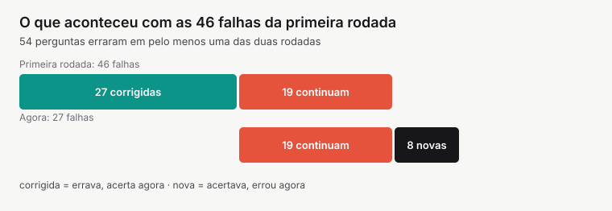
  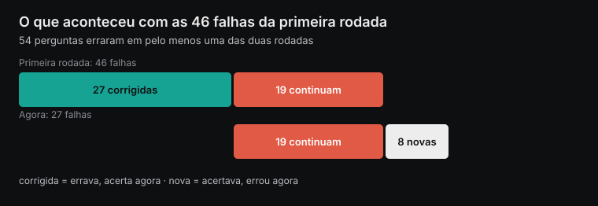
</Frame>

#### O que mudou no chatcli

Ler os transcripts das falhas mostrou que, quase sempre, a resposta estava diante do chatcli. Ele parava depois do primeiro resultado com cara de bom, contava dias de cabeça ou recebia uma página cortada. Cada causa virou uma mudança de produto:

| Mudança | O que estava errado |
|---|---|
| Resultados de sessão e memória chegam inteiros ao modelo ([#1869](https://github.com/diillson/chatcli/pull/1869)) | o compressor de contexto lia uma conversa que fala de erros e caminhos de arquivo como se fosse um log e trocava o miolo por "152 linhas omitidas"; uma pergunta em sete foi afetada, e essas acertavam 84% contra 91% |
| Idades em dias de calendário ([#1871](https://github.com/diillson/chatcli/pull/1871)) | uma sessão salva dia 15 às 18:11 e consultada dia 18 à 01:48 aparecia como "2d ago" (horas decorridas arredondadas para baixo) em vez de 3 |
| [Busca de sessões](/pt/context/session-search#busca-ranqueada-bm25) graduada | quando alguma sessão tinha todos os termos, as que tinham só alguns eram escondidas, e uma atualização posterior costuma usar palavras diferentes da primeira menção |
| Falas do usuário primeiro nos trechos | turnos longos do assistente expulsavam a linha em que o usuário disse o número |
| [`@date`](/pt/tools/date) | dias entre duas datas, "sábado passado", "há 3 semanas" eram calculados de cabeça |
| Um protocolo de completude no [cartão de memória](/pt/context/bootstrap-memory) | buscar cada fato necessário com outras palavras, abrir as sessões em vez de julgar por trecho, preferir a afirmação mais recente do mesmo escopo |
| Prefixo de token do park continua texto ([#1870](https://github.com/diillson/chatcli/pull/1870)) | achado por um teste que falhava uma vez em cem rodadas: um prefixo só de dígitos virava número |

#### O que piorou

A recusa foi de 27 de 30 para 25: o protocolo manda o agente se comprometer com a leitura mais bem sustentada, e em mais duas perguntas sem resposta ele se comprometeu com uma resposta. O custo por pergunta subiu cerca de 16% e os tokens de entrada cerca de 9%.

#### Onde ainda falha

Das 27 falhas, 17 são raciocínio com a evidência diante do modelo (uma contagem que depende de como se lê "liderou", uma data que não bate com nenhuma data dita), 5 responderam algo que o histórico não permite responder, 4 disseram que a evidência não estava lá e 1 achou só parte dela. Algumas dessas perguntas têm gabarito discutível; ficam como estão e contam como erro.

  </Accordion>
  <Accordion title="Primeira rodada (20/10/2026): a base, 454 de 500" icon="clock-rotate-left">

<Frame>
  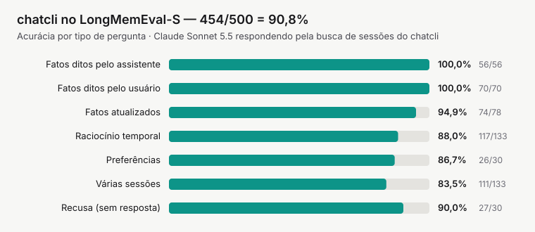
  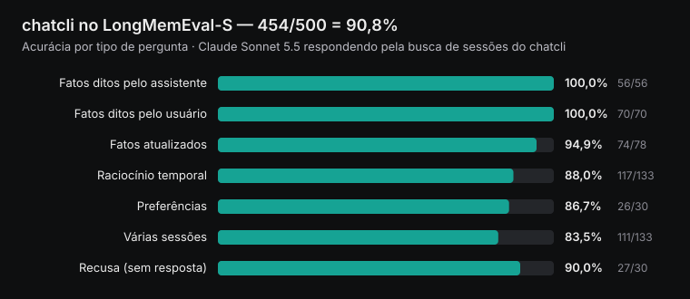
</Frame>

**454 de 500 corretas: 90,8%** (intervalo de confiança de 95%: 87,9% a 93,0%). Pela média dos seis tipos de pergunta, em que cada tipo pesa igual: **92,2%**.

| Tipo de pergunta | Acertos | Acurácia | IC 95% |
|---|---|---|---|
| Fatos ditos pelo usuário | 70/70 | **100,0%** | 94,8–100,0% |
| Fatos ditos pelo assistente | 56/56 | **100,0%** | 93,6–100,0% |
| Fatos atualizados | 74/78 | **94,9%** | 87,5–98,0% |
| Raciocínio temporal | 117/133 | **88,0%** | 81,4–92,5% |
| Preferências | 26/30 | **86,7%** | 70,3–94,7% |
| Várias sessões | 111/133 | **83,5%** | 76,2–88,8% |
| Recusa (sem resposta, em todos os tipos) | 27/30 | **90,0%** | |

#### Nota fora da amostra de ajuste

Antes da rodada completa, uma amostra de 60 perguntas (10 por tipo, semente fixa) foi usada para achar e corrigir fraquezas do chatcli. Essas 60 deram 96,7% na rodada final, então não são um teste neutro. **Nas outras 440 perguntas o chatcli acertou 396/440 = 90,0%** (IC 95% de 86,8% a 92,5%), com a mesma média por tipo de 92,2%. É o número conservador.

#### Onde falhou na primeira rodada

A primeira rodada registrou, para cada pergunta, quais sessões salvas contêm a resposta segundo o gabarito do dataset e se essas sessões chegaram ao modelo. Isso separa **achar** de **raciocinar**.

<Frame>
  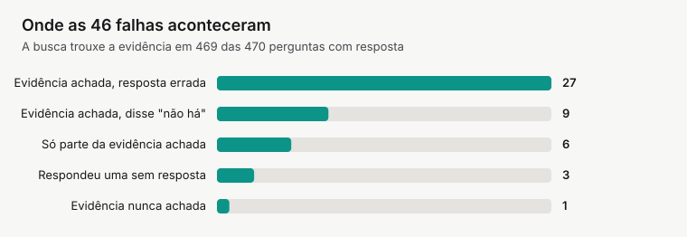
  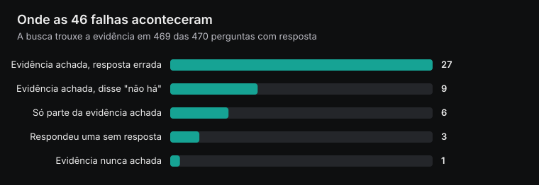
</Frame>

**A busca não é o gargalo.** A sessão com a resposta chegou ao modelo em 469 das 470 perguntas que têm resposta. Das 46 falhas, só uma foi de busca. O resto é julgamento:

- **Contar entre sessões** (várias sessões, 22 falhas): "Quantos projetos concluí desde que comecei as aulas de pintura?" — o chatcli achou 4 dos 5.
- **Aritmética e ordem de datas** (temporal, 16 falhas): "Qual livro terminei primeiro?" quando uma sessão diz "no fim de semana passado" e outra "acabei de terminar".
- **Cautela demais**: em 9 perguntas a evidência estava diante do modelo e ele respondeu "isso não está nas nossas conversas".
- **Ousadia demais**: em 3 das 30 perguntas sem resposta ele chutou em vez de recusar.

<Note>
Duas das 46 falhas tiveram outra causa, achada lendo os transcripts: uma busca por "St. Mary's Church" levou um apóstrofo sem escape que cortou a tool call. Esse bug do parser está corrigido no [#1842](https://github.com/diillson/chatcli/pull/1842), e as duas perguntas passam quando rodadas de novo. Os 90,8% acima são a nota medida, sem essa correção.
</Note>

#### O que a primeira rodada mudou no chatcli

Rodar o LongMemEval achou bugs reais, e cada um foi corrigido no próprio chatcli, não no teste:

| Mudança | O que estava errado |
|---|---|
| [`CHATCLI_NOW`](/pt/reference/environment-variables) (#1833) | datas relativas eram sempre contadas a partir de hoje, então uma conversa reproduzida do passado lia "há duas semanas" contra o dia errado |
| `CHATCLI_STATE_DIR` (#1835) | não havia como rodar uma instalação separada e isolada sem mudar o `HOME` |
| Refresh do OAuth entre processos (#1836) | dois processos do chatcli renovando o token ao mesmo tempo podiam deslogar o usuário |
| Idade das sessões pela data de referência (#1837) | a idade ao lado de cada sessão salva usava o relógio real: "1282 dias atrás" em vez de "21 dias atrás" |
| Nunca cortar um caractere UTF-8 (#1838) | cerca de 130 limites de texto podiam partir um caractere, mandando UTF-8 inválido ao modelo |
| `--timeout` cobre o stdin (#1839) | `chatcli -p` com stdin aberto esperava para sempre |
| Resultados datados, `from` / `to` / `as_of` (#1840) | a busca não trazia data; uma janela só com data final era ignorada |
| Apóstrofo nos argumentos de tool (#1842) | uma busca como "St. Mary's" cortava a tool call e disparava a trava de segurança |

Na amostra de 60 perguntas, essas mudanças levaram raciocínio temporal de 8/10 para 10/10, fatos atualizados de 8/10 para 9/10 e várias sessões de 9/10 para 10/10, sem nenhuma pergunta piorando.

  </Accordion>
</AccordionGroup>

---

## Custo e velocidade

Custo, chamadas de ferramenta, entrada e tempo por pergunta em cada rodada completa. A tabela abaixo detalha as duas primeiras rodadas; as seguintes estão na tabela da [checagem mensal](#checagem-mensal) e no `summary.md` de cada pacote.

<Frame>
  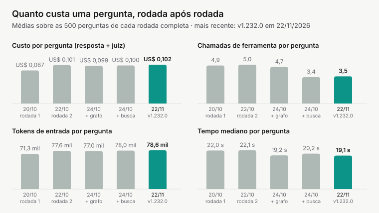
  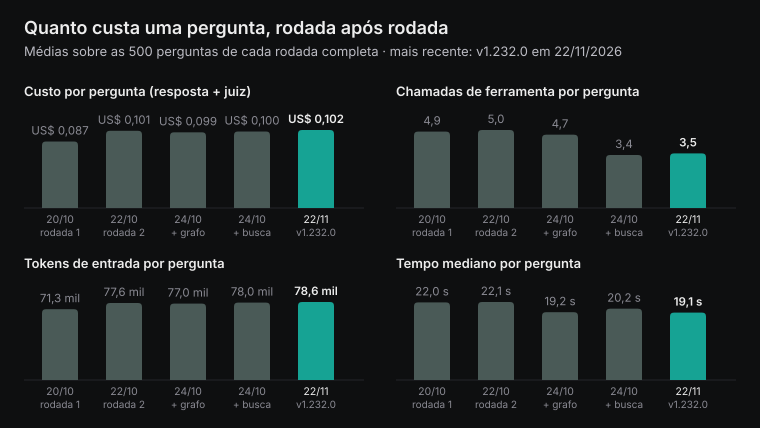
</Frame>

| | Primeira rodada | Segunda rodada, main mergeada |
|---|---|---|
| Tempo mediano por pergunta | 22,0 s (p90 37,1 s, máximo 80,0 s) | 22,1 s (p90 32,5 s, máximo 68,4 s) |
| Custo médio por pergunta | US$ 0,083 respondendo (p95 US$ 0,126) | US$ 0,097 respondendo (p95 US$ 0,139) |
| Rodada inteira | US$ 41,39 respondendo + US$ 1,89 julgando, cerca de 1 hora com 4 em paralelo | US$ 48,47 respondendo + US$ 1,94 julgando, cerca de 1 hora com 4 em paralelo |
| Tokens de entrada por pergunta | 71 mil em média | 78 mil em média |
| Tool calls por pergunta | 4,9 em média | 5,0 em média |
| Execuções com erro | 0 de 500 | 0 de 500 |

Na segunda rodada o chatcli usou `@session search` 1.241 vezes, `@session get` 891 vezes e `@memory recall` 285 vezes, e o novo [`@date`](/pt/tools/date) 62 vezes em 52 perguntas. Em 94 perguntas ele limitou as buscas por data por conta própria, com os flags `from`, `to` e `as_of` da [busca de sessões](/pt/context/session-search#datas-from-to-e-as_of) (162 chamadas). Ele nunca foi à web. O custo subiu cerca de 16% porque a entrada cresceu cerca de 9%: o cartão de memória mais longo, a definição da ferramenta `@date` e as páginas de sessão que deixaram de ser cortadas.

Na primeira rodada o chatcli usou `@session search` 1.068 vezes, `@session get` 967 vezes e `@memory recall` 344 vezes. Em 66 perguntas ele limitou as buscas por data por conta própria, com os flags `from`, `to` e `as_of` da [busca de sessões](/pt/context/session-search#datas-from-to-e-as_of) (137 chamadas). Ele nunca foi à web.

---

## Lendo os números com honestidade

<AccordionGroup>
  <Accordion title="A segunda rodada e a divisão">
    A metade de desenvolvimento (240 perguntas) foi lida para desenhar as mudanças, então seu resultado é otimista por construção. A metade de validação (260) não foi olhada até a primeira rodada pós-mudança terminar; a rodada na main mergeada cobre as 500 de novo, então a validação dela (243 corretas, 93,5%, intervalo de 95% de 89,8–95,9%) é uma medida nova. Uma rodada por pergunta, então o número oscila uns ±4. O custo por pergunta subiu de US$ 0,087 para US$ 0,101 e os tokens de entrada de 71 mil para 77 mil, com as chamadas de ferramenta por pergunta parecidas (4,9 e 5,0): o cartão de memória mais longo, a definição da ferramenta `@date` e as páginas de sessão que deixaram de ser cortadas explicam a entrada maior.
  </Accordion>
  <Accordion title="Não comparável diretamente com notas julgadas pelo GPT-4o">
    O juiz de referência do artigo é o GPT-4o. Esta rodada usou os mesmos prompts oficiais com o Claude Sonnet 5.5 como juiz, então a nota não é diretamente comparável com números de leaderboard julgados pelo GPT-4o.
  </Accordion>
  <Accordion title="A terceira rodada">
    A busca de sessões foi desenhada a partir de falhas de desenvolvimento e de uma medição sobre todas as sessões de evidência (quantas não têm palavra em comum com a pergunta), não a partir de nenhuma resposta de validação. As três falhas de validação lidas ao checar a rodada base ficam de fora na terceira linha da tabela. A metade de desenvolvimento cair 3 enquanto a de validação subiu 7 está dentro dos ±4 que uma rodada oscila em cada metade.
  </Accordion>
  <Accordion title="As checagens mensais">
    Uma checagem mensal é um teste de regressão, não um resultado novo para comemorar. Ela roda as mesmas 500 perguntas na release mais recente e pergunta se a memória piorou. Uma rodada sozinha oscila uns ±4 perguntas com o mesmo binário, então uma diferença menor que isso é reportada como empate, para qualquer lado. Nenhum transcript da rodada de novembro de 2026 foi lido e nenhuma mudança foi desenhada a partir dela; as perguntas perdidas foram só rodadas de novo.
  </Accordion>
  <Accordion title="As 60 perguntas de ajuste">
    A amostra de 60 perguntas orientou as correções acima. Os 90,0% nas outras 440 são o número que nunca foi visto durante o ajuste.
  </Accordion>
  <Accordion title="Uma execução por pergunta">
    Modelos variam entre execuções. Uma pergunta no limite pode virar para um lado ou para o outro numa nova rodada.
  </Accordion>
  <Accordion title="O que significa 'evidência trazida'">
    O nome de uma sessão de evidência apareceu no que o modelo viu: resultados de busca, o bloco de auto-recall ou uma página que ele leu. Mostra que a busca chegou à conversa certa, não que o modelo leu a frase exata.
  </Accordion>
  <Accordion title="Os nomes das sessões têm data">
    As sessões salvas se chamaram `chat-<data>-<índice>`; os ids do próprio dataset revelariam quais sessões têm a resposta. A data no nome é a mesma informação que todo resultado de busca mostra.
  </Accordion>
</AccordionGroup>

---

## Os dados

Tudo da rodada é público no repositório do chatcli, em [`evals/longmemeval`](https://github.com/diillson/chatcli/tree/main/evals/longmemeval):

| Arquivo | O que contém |
|---|---|
| `results/2026-11-22/` | a checagem mensal de novembro de 2026 na v1.232.0 (resultado mais recente): manifest, as 500 respostas, resumos (todas e só validação), `split.json`, os transcripts das 19 falhas, `comparison.md` (a checagem contra a rodada anterior) e `rerun-regressed.jsonl` (a nova execução das 8 perguntas perdidas) |
| `results/2026-11-22-claude-code/` | as mesmas 500 perguntas pelo Claude Code 2.1.330: manifest, as 500 respostas, resumos, os transcripts das 37 falhas e `comparison.md` (pergunta a pergunta contra a rodada do chatcli) |
| `results/2026-10-24-session-search/` | a terceira rodada com a busca de sessões (a referência das checagens mensais): manifest, as 500 respostas, resumos (todas e só validação), `split.json` e os transcripts das 21 falhas |
| `results/2026-10-24/` | a rodada base da terceira rodada (main depois do grafo de memória), mesmos arquivos, 25 falhas |
| `results/2026-10-22-merged/` | a segunda rodada na main mergeada: manifest, as 500 respostas, resumos (todas e só validação), `split.json` (desenvolvimento ou validação por pergunta) e os transcripts das 27 falhas |
| `results/2026-10-22/` | a rodada feita na branch antes do merge, mesmos arquivos |
| `results/2026-10-20/manifest.json` | commit, sha256 do binário e do dataset, modelos, prompt, configurações, início e fim |
| `results/2026-10-20/results.jsonl` | as 500 perguntas: a resposta de referência, a resposta do chatcli, o veredito, tempo, tokens, custo, cada tool call e quais sessões de evidência foram vistas e abertas |
| `results/2026-10-20/summary.json` | todos os agregados desta página, com intervalos de confiança e a lista de falhas |
| `results/2026-10-20/failure-transcripts.jsonl.gz` | os transcripts completos do chatcli nas 46 falhas |
| `lme_claude.py` | o driver do comparativo com o Claude Code: histórico em arquivos de transcrição, mesma moldura de pergunta, mesmo juiz |
| `lme.py`, `analyze.py`, `compare.py`, `package.py`, `judge_prompts.py` | o driver, a análise, a checagem de regressão contra uma rodada anterior, o script que transforma uma rodada num pacote publicado e os prompts oficiais do juiz |

### Rode você mesmo

```bash
curl -LO https://huggingface.co/datasets/xiaowu0162/longmemeval-cleaned/resolve/main/longmemeval_s_cleaned.json
go build -o chatcli-bench .
: > empty.env
python3 -I evals/longmemeval/lme.py --data "$PWD/longmemeval_s_cleaned.json" --out "$PWD/run" \
  --bin "$PWD/chatcli-bench" --dotenv "$PWD/empty.env" --per-type 1000 --workers 4 < /dev/null
python3 -I evals/longmemeval/analyze.py "$PWD/run"
# checagem de regressão contra a última rodada publicada:
python3 -I evals/longmemeval/compare.py "$PWD/run" evals/longmemeval/results/2026-11-22
```

Você precisa de um login do Claude no chatcli (OAuth ou API key). Páginas relacionadas: [Memória](/pt/context/bootstrap-memory), [Busca de conversas](/pt/context/session-search), [Evals](/pt/agents/harness/evals).
