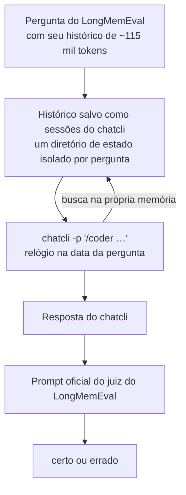

Um assistente com quem você trabalha há meses precisa lembrar do que você contou: a decisão de três semanas atrás, o número que você corrigiu na terça passada, a cidade para onde você se mudou, e também quando dizer "você nunca me contou isso". O **LongMemEval** mede exatamente isso, e rodamos as 500 perguntas dele no chatcli.

<CardGroup cols={4}>
  <Card title="92,3%" icon="flask">
    das 260 perguntas de validação, nenhuma lida durante o ajuste do chatcli (240 corretas)
  </Card>
  <Card title="94,4%" icon="bullseye">
    472 de 500 perguntas respondidas corretamente, contra 90,8% na primeira rodada
  </Card>
  <Card title="470 / 470" icon="magnifying-glass">
    perguntas em que a busca do chatcli trouxe a evidência
  </Card>
  <Card title="22 s · US$ 0,10" icon="gauge-high">
    tempo mediano e custo médio por pergunta
  </Card>
</CardGroup>

<Frame>
  
  
</Frame>

*O gráfico acima é da primeira rodada (20/10/2026); os números da segunda rodada estão nas seções seguintes.*

<Card title="A história por trás dos números" icon="linkedin" href="https://www.linkedin.com/pulse/fiz-500-perguntas-%C3%A0-mem%C3%B3ria-do-meu-agente-ele-acertou-edilson-freitas-fyqff/">
  O artigo no LinkedIn mostra as 500 perguntas, as falhas reais, os bugs que a rodada encontrou e o que mudou depois.
</Card>

---

## O que é o LongMemEval

O [LongMemEval](https://github.com/xiaowu0162/LongMemEval) é um benchmark do artigo *LongMemEval: Benchmarking Chat Assistants on Long-Term Interactive Memory* (Di Wu, Hongwei Wang, Wenhao Yu, Yuwei Zhang, Kai-Wei Chang e Dong Yu, **ICLR 2025**). São 500 perguntas curadas à mão. Cada pergunta vem com o próprio histórico de sessões de chat, com data e hora. Na variante **S**, esse histórico tem cerca de 115 mil tokens, umas 40 a 50 sessões de conversa do dia a dia, e a evidência da resposta está escondida em algum lugar ali dentro.

As perguntas testam cinco habilidades:

| Habilidade | O que pede | Exemplo do dataset |
|---|---|---|
| **Extração de informação** | lembrar um detalhe que o usuário ou o assistente disse | "What degree did I graduate with?" |
| **Raciocínio entre sessões** | juntar fatos espalhados por várias sessões | "How many MCU films did I watch in the last 3 months?" |
| **Raciocínio temporal** | raciocinar sobre quando as coisas aconteceram | "How many weeks ago did I start using Ibotta?" |
| **Fatos atualizados** | usar o valor mais recente quando um fato mudou | "How many pre-1920 coins do I have?" (37, depois 38) |
| **Recusa** | admitir quando o histórico não tem a resposta | "At which university did I present a poster for my undergrad course research project?" (nunca foi dito) |

### Por que importa

- **É difícil de propósito.** O artigo relata que assistentes comerciais e LLMs de contexto longo perdem 30% de acurácia ao memorizar informação ao longo de interações contínuas. Uma janela de contexto maior, sozinha, não resolve.
- **Testa a falha que o usuário de fato vê.** Um assistente que esquece uma correção, mistura duas viagens ou inventa uma resposta que nunca recebeu perde a confiança rápido. O LongMemEval mede cada um desses casos separadamente.
- **É reproduzível.** O dataset, as perguntas, as respostas de referência e os prompts do juiz são públicos (MIT), então qualquer pessoa pode rodar de novo e comparar.

---

## Como o chatcli foi testado

O objetivo era testar o chatcli do jeito que você o usa, não testar o modelo. **Nada foi colado no prompt.** O histórico de cada pergunta virou sessões salvas do próprio chatcli, e ele teve que achar a evidência com as ferramentas de memória dele.



<Steps>
  <Step title="Uma instalação isolada por pergunta">
    Um [`CHATCLI_STATE_DIR`](/pt/reference/environment-variables) novo guarda o histórico da pergunta como sessões salvas; a data de modificação de cada arquivo é a data da sessão. Sua memória real nunca se mistura, e seu login é reaproveitado no lugar via `CHATCLI_AUTH_DIR`.
  </Step>
  <Step title="O relógio no dia da pergunta">
    O [`CHATCLI_NOW`](/pt/reference/environment-variables) é a data da pergunta, então "há duas semanas" significa duas semanas antes da pergunta, não antes da execução.
  </Step>
  <Step title="O chatcli responde sozinho">
    `chatcli -p "/coder …"` com Claude Sonnet 5.5 e uma única instrução neutra: responda pelas nossas conversas anteriores e diga se elas não têm a resposta. O chatcli decide quais tools chamar.
  </Step>
  <Step title="O juiz oficial">
    Cada resposta é avaliada com os prompts oficiais de verificação do LongMemEval, sem alteração, rodando com Claude Sonnet 5.5.
  </Step>
</Steps>

---

## Resultados, segunda rodada (22/10/2026)

Depois da primeira rodada, as falhas do chatcli foram lidas e as causas corrigidas no produto (listadas abaixo). As 500 perguntas rodaram de novo, com o mesmo dataset, os mesmos prompts do juiz e o mesmo modelo.

Para o número novo ser honesto, as perguntas foram separadas de antemão por uma regra fixa (`sha1(question_id)`, par ou ímpar): **240 perguntas de desenvolvimento**, cujas falhas foram lidas para desenhar as mudanças, e **260 de validação**, que ninguém olhou até a rodada terminar.

| | Primeira rodada | Segunda rodada |
|---|---|---|
| Todas as 500 perguntas | 454 = 90,8% (87,9–93,0%) | **472 = 94,4%** (92,0–96,1%) |
| Validação, 260 nunca lidas | 90,0% nas 440 não usadas no ajuste | **240 = 92,3%** (88,4–95,0%) |
| Desenvolvimento, 240 | | 232 = 96,7% (otimista: são as perguntas estudadas) |
| Evidência que chegou ao modelo | 469 / 470 | 470 / 470 |
| Custo por pergunta | US$ 0,087 | US$ 0,100 |

A linha de validação é a que vale citar. O intervalo dela ainda chega abaixo de 92%, e uma rodada oscila uns ±4 acertos: em três rodadas completas do código da primeira rodada, 53 das 500 perguntas mudaram de resultado pelo menos uma vez.

| Tipo de pergunta | Primeira rodada | Segunda rodada | das quais validação |
|---|---|---|---|
| Fatos ditos pelo usuário | 70/70 | 70/70 | 34/34 |
| Fatos ditos pelo assistente | 56/56 | 55/56 | 27/28 |
| Fatos atualizados | 74/78 | 77/78 | 39/40 |
| Raciocínio temporal | 117/133 | 124/133 | 63/67 |
| Preferências | 26/30 | 28/30 | 16/18 |
| Várias sessões | 111/133 | 118/133 | 61/73 |
| Recusa (em todos os tipos) | 27/30 | 26/30 | 10/13 |

### O que mudou no chatcli

Ler os transcripts das falhas mostrou que, quase sempre, a resposta estava diante do chatcli. Ele parava depois do primeiro resultado com cara de bom, contava dias de cabeça ou recebia uma página cortada. Cada causa virou uma mudança de produto:

| Mudança | O que estava errado |
|---|---|
| Resultados de sessão e memória chegam inteiros ao modelo ([#1869](https://github.com/diillson/chatcli/pull/1869)) | o compressor de contexto lia uma conversa que fala de erros e caminhos de arquivo como se fosse um log e trocava o miolo por "152 linhas omitidas"; uma pergunta em sete foi afetada, e essas acertavam 84% contra 91% |
| Idades em dias de calendário ([#1871](https://github.com/diillson/chatcli/pull/1871)) | uma sessão salva dia 15 às 18:11 e consultada dia 18 à 01:48 aparecia como "2d ago" (horas decorridas arredondadas para baixo) em vez de 3 |
| [Busca de sessões](/pt/context/session-search#busca-ranqueada-bm25) graduada | quando alguma sessão tinha todos os termos, as que tinham só alguns eram escondidas, e uma atualização posterior costuma usar palavras diferentes da primeira menção |
| Falas do usuário primeiro nos trechos | turnos longos do assistente expulsavam a linha em que o usuário disse o número |
| [`@date`](/pt/tools/date) | dias entre duas datas, "sábado passado", "há 3 semanas" eram calculados de cabeça |
| Um protocolo de completude no [cartão de memória](/pt/context/bootstrap-memory) | buscar cada fato necessário com outras palavras, abrir as sessões em vez de julgar por trecho, preferir a afirmação mais recente do mesmo escopo |

### Onde ainda falha

Das 28 falhas, 22 são raciocínio com a evidência diante do modelo (uma contagem que depende de como se lê "liderou", uma data que não bate com nenhuma data dita), 4 responderam algo que o histórico não permite responder, 1 disse que a evidência não estava lá e 1 achou só parte dela. Algumas dessas perguntas têm gabarito discutível; ficam como estão e contam como erro.

---

## Resultados, primeira rodada (20/10/2026)

**454 de 500 corretas: 90,8%** (intervalo de confiança de 95%: 87,9% a 93,0%). Pela média dos seis tipos de pergunta, em que cada tipo pesa igual: **92,2%**.

| Tipo de pergunta | Acertos | Acurácia | IC 95% |
|---|---|---|---|
| Fatos ditos pelo usuário | 70/70 | **100,0%** | 94,8–100,0% |
| Fatos ditos pelo assistente | 56/56 | **100,0%** | 93,6–100,0% |
| Fatos atualizados | 74/78 | **94,9%** | 87,5–98,0% |
| Raciocínio temporal | 117/133 | **88,0%** | 81,4–92,5% |
| Preferências | 26/30 | **86,7%** | 70,3–94,7% |
| Várias sessões | 111/133 | **83,5%** | 76,2–88,8% |
| Recusa (sem resposta, em todos os tipos) | 27/30 | **90,0%** | |

### Nota fora da amostra de ajuste

Antes da rodada completa, uma amostra de 60 perguntas (10 por tipo, semente fixa) foi usada para achar e corrigir fraquezas do chatcli. Essas 60 deram 96,7% na rodada final, então não são um teste neutro. **Nas outras 440 perguntas o chatcli acertou 396/440 = 90,0%** (IC 95% de 86,8% a 92,5%), com a mesma média por tipo de 92,2%. É o número conservador.

---

## Onde falha

A rodada registra, para cada pergunta, quais sessões salvas contêm a resposta segundo o gabarito do dataset e se essas sessões chegaram ao modelo. Isso separa **achar** de **raciocinar**.

<Frame>
  
  
</Frame>

**A busca não é o gargalo.** A sessão com a resposta chegou ao modelo em 469 das 470 perguntas que têm resposta. Das 46 falhas, só uma foi de busca. O resto é julgamento:

- **Contar entre sessões** (várias sessões, 22 falhas): "Quantos projetos concluí desde que comecei as aulas de pintura?" — o chatcli achou 4 dos 5.
- **Aritmética e ordem de datas** (temporal, 16 falhas): "Qual livro terminei primeiro?" quando uma sessão diz "no fim de semana passado" e outra "acabei de terminar".
- **Cautela demais**: em 9 perguntas a evidência estava diante do modelo e ele respondeu "isso não está nas nossas conversas".
- **Ousadia demais**: em 3 das 30 perguntas sem resposta ele chutou em vez de recusar.

<Note>
Duas das 46 falhas tiveram outra causa, achada lendo os transcripts: uma busca por "St. Mary's Church" levou um apóstrofo sem escape que cortou a tool call. Esse bug do parser está corrigido no [#1842](https://github.com/diillson/chatcli/pull/1842), e as duas perguntas passam quando rodadas de novo. Os 90,8% acima são a nota medida, sem essa correção.
</Note>

---

## Custo e velocidade

| | |
|---|---|
| Tempo mediano por pergunta | 22,0 s (p90 37,1 s, máximo 80,0 s) |
| Custo médio por pergunta | US$ 0,083 respondendo (p95 US$ 0,126) |
| Rodada inteira | US$ 41,39 respondendo + US$ 1,89 julgando, cerca de 1 hora com 4 em paralelo |
| Tokens de entrada por pergunta | 71 mil em média |
| Tool calls por pergunta | 4,9 em média |
| Execuções com erro | 0 de 500 |

O chatcli usou `@session search` 1.068 vezes, `@session get` 967 vezes e `@memory recall` 344 vezes. Em 66 perguntas ele limitou as buscas por data por conta própria, com os flags `from`, `to` e `as_of` da [busca de sessões](/pt/context/session-search#datas-from-to-e-as_of) (137 chamadas). Ele nunca foi à web.

---

## O que o benchmark mudou no chatcli

Rodar o LongMemEval achou bugs reais, e cada um foi corrigido no próprio chatcli, não no teste:

| Mudança | O que estava errado |
|---|---|
| [`CHATCLI_NOW`](/pt/reference/environment-variables) (#1833) | datas relativas eram sempre contadas a partir de hoje, então uma conversa reproduzida do passado lia "há duas semanas" contra o dia errado |
| `CHATCLI_STATE_DIR` (#1835) | não havia como rodar uma instalação separada e isolada sem mudar o `HOME` |
| Refresh do OAuth entre processos (#1836) | dois processos do chatcli renovando o token ao mesmo tempo podiam deslogar o usuário |
| Idade das sessões pela data de referência (#1837) | a idade ao lado de cada sessão salva usava o relógio real: "1282 dias atrás" em vez de "21 dias atrás" |
| Nunca cortar um caractere UTF-8 (#1838) | cerca de 130 limites de texto podiam partir um caractere, mandando UTF-8 inválido ao modelo |
| `--timeout` cobre o stdin (#1839) | `chatcli -p` com stdin aberto esperava para sempre |
| Resultados datados, `from` / `to` / `as_of` (#1840) | a busca não trazia data; uma janela só com data final era ignorada |
| Apóstrofo nos argumentos de tool (#1842) | uma busca como "St. Mary's" cortava a tool call e disparava a trava de segurança |

Na amostra de 60 perguntas, essas mudanças levaram raciocínio temporal de 8/10 para 10/10, fatos atualizados de 8/10 para 9/10 e várias sessões de 9/10 para 10/10, sem nenhuma pergunta piorando.

---

## Lendo os números com honestidade

<AccordionGroup>
  <Accordion title="A segunda rodada e a divisão">
    A metade de desenvolvimento (240 perguntas) foi lida para desenhar as mudanças, então seus 96,7% são otimistas por construção. A metade de validação (260) não foi olhada até a rodada terminar: 92,3%, com intervalo de 95% de 88,4–95,0%. Uma rodada por pergunta, então o número oscila uns ±4. O custo por pergunta subiu de US$ 0,087 para US$ 0,100 e os tokens de entrada de 71 mil para 77 mil, com as chamadas de ferramenta por pergunta iguais (4,9): o cartão de memória mais longo, a definição da ferramenta `@date` e as páginas de sessão que deixaram de ser cortadas explicam a entrada maior.
  </Accordion>
  <Accordion title="Não comparável diretamente com notas julgadas pelo GPT-4o">
    O juiz de referência do artigo é o GPT-4o. Esta rodada usou os mesmos prompts oficiais com o Claude Sonnet 5.5 como juiz, então a nota não é diretamente comparável com números de leaderboard julgados pelo GPT-4o.
  </Accordion>
  <Accordion title="As 60 perguntas de ajuste">
    A amostra de 60 perguntas orientou as correções acima. Os 90,0% nas outras 440 são o número que nunca foi visto durante o ajuste.
  </Accordion>
  <Accordion title="Uma execução por pergunta">
    Modelos variam entre execuções. Uma pergunta no limite pode virar para um lado ou para o outro numa nova rodada.
  </Accordion>
  <Accordion title="O que significa 'evidência trazida'">
    O nome de uma sessão de evidência apareceu no que o modelo viu: resultados de busca, o bloco de auto-recall ou uma página que ele leu. Mostra que a busca chegou à conversa certa, não que o modelo leu a frase exata.
  </Accordion>
  <Accordion title="Os nomes das sessões têm data">
    As sessões salvas se chamaram `chat-<data>-<índice>`; os ids do próprio dataset revelariam quais sessões têm a resposta. A data no nome é a mesma informação que todo resultado de busca mostra.
  </Accordion>
</AccordionGroup>

---

## Os dados

Tudo da rodada é público no repositório do chatcli, em [`evals/longmemeval`](https://github.com/diillson/chatcli/tree/main/evals/longmemeval):

| Arquivo | O que contém |
|---|---|
| `results/2026-10-22/` | a segunda rodada: manifest, as 500 respostas, resumos (todas e só validação), `split.json` (desenvolvimento ou validação por pergunta) e os transcripts das 28 falhas |
| `results/2026-10-20/manifest.json` | commit, sha256 do binário e do dataset, modelos, prompt, configurações, início e fim |
| `results/2026-10-20/results.jsonl` | as 500 perguntas: a resposta de referência, a resposta do chatcli, o veredito, tempo, tokens, custo, cada tool call e quais sessões de evidência foram vistas e abertas |
| `results/2026-10-20/summary.json` | todos os agregados desta página, com intervalos de confiança e a lista de falhas |
| `results/2026-10-20/failure-transcripts.jsonl.gz` | os transcripts completos do chatcli nas 46 falhas |
| `lme.py`, `analyze.py`, `judge_prompts.py` | o driver, a análise e os prompts oficiais do juiz |

### Rode você mesmo

```bash
curl -LO https://huggingface.co/datasets/xiaowu0162/longmemeval-cleaned/resolve/main/longmemeval_s_cleaned.json
go build -o chatcli-bench .
: > empty.env
python3 -I evals/longmemeval/lme.py --data "$PWD/longmemeval_s_cleaned.json" --out "$PWD/run" \
  --bin "$PWD/chatcli-bench" --dotenv "$PWD/empty.env" --per-type 1000 --workers 4 < /dev/null
python3 -I evals/longmemeval/analyze.py "$PWD/run"
```

Você precisa de um login do Claude no chatcli (OAuth ou API key). Páginas relacionadas: [Memória](/pt/context/bootstrap-memory), [Busca de conversas](/pt/context/session-search), [Evals](/pt/agents/harness/evals).
